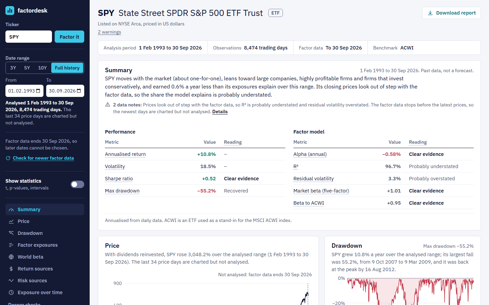
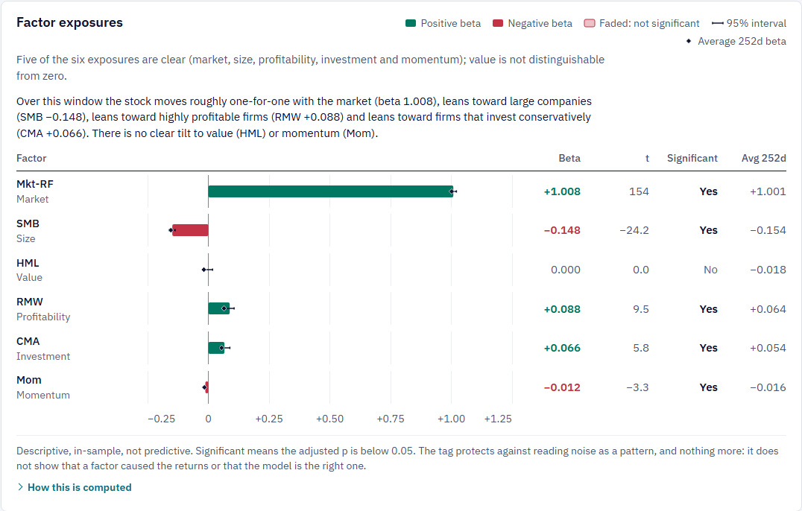
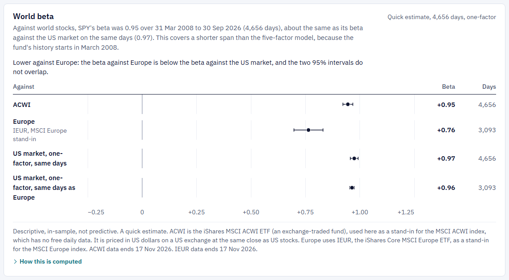
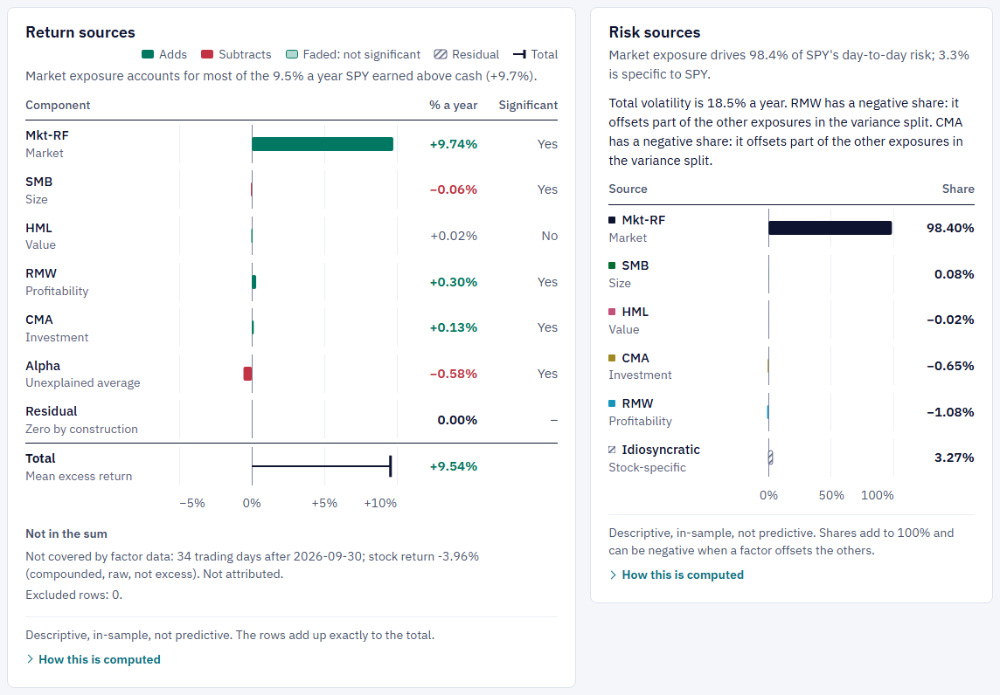
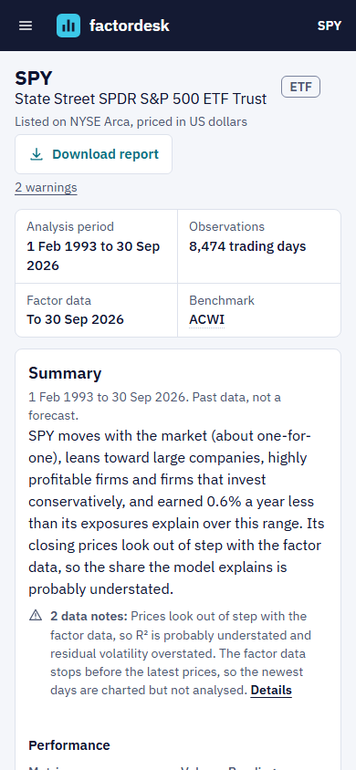
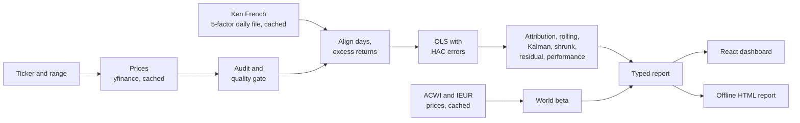

# factordesk

**See what drives a stock's returns, in plain language, with the statistics one click away.**

[](https://github.com/lbsm2017/factordesk/actions/workflows/ci.yml)
[](LICENSE)


factordesk runs a Fama-French five-factor analysis of a single stock or ETF on your own machine.
Type a ticker and press **Factor it**. factordesk downloads the daily prices and the public Ken
French factor data, regresses the stock's excess returns on the five factors, and shows the result
as a local dashboard or as a single offline HTML file.

It answers three questions:

1. **What is this stock exposed to?** Market, size, value, profitability and investment, each with
   a 95% interval and a clear "significant or not".
2. **Where did the return and the risk come from?** An exact split of the average return and of the
   variance into factor parts and a stock-specific part.
3. **Did it earn anything beyond those exposures, and does that hold up without hindsight?** Alpha,
   residual return with point-in-time betas, and betas that move over time.

factordesk describes the past. It does not forecast, rank or recommend anything.



<sub>Screenshots in this README show SPY over its full history (1 Feb 1993 to 30 Sep 2026), taken on
19 Nov 2026 from a local run. Prices come from Yahoo Finance and are shown for illustration only;
no price data is stored in this repository.</sub>

## Contents

- [Highlights](#highlights)
- [Quick start](#quick-start)
- [A tour of the dashboard](#a-tour-of-the-dashboard)
- [How it works](#how-it-works)
- [Method](#method)
- [Scientific rigour](#scientific-rigour)
- [Installation](#installation)
- [Usage](#usage)
- [Project layout](#project-layout)
- [Tests and quality checks](#tests-and-quality-checks)
- [Data sources and licences](#data-sources-and-licences)
- [Limitations](#limitations)
- [Status and roadmap](#status-and-roadmap)
- [Documentation map](#documentation-map)
- [Key references](#key-references)
- [Cite, contribute, licence](#cite-contribute-licence)

## Highlights

- **Verdict first.** Every page opens with one plain sentence on what the stock does, followed by
  two short tables (Performance and Factor model) with a one-word reading for each number. Every
  panel then opens with its own result sentence.
- **Statistics on demand.** A **Show statistics** switch reveals t-statistics, p-values and
  intervals. With it off, the page reads like a research note; with it on, like a regression table.
- **Careful inference.** Newey-West (HAC) standard errors, Benjamini-Hochberg correction across the
  five betas, and return and risk attribution that adds up exactly to the total.
- **Historical performance.** Annualised return, volatility, Sharpe ratio with an approximate 95%
  interval, maximum drawdown with dates, and the five largest falls.
- **World beta.** A quick single-factor beta against world stocks (ACWI) and Europe (IEUR), each
  compared with the US market beta on the same days.
- **Betas over time.** Rolling betas (126 or 252 days), Kalman-filter betas that use only past
  data, and shrunk betas pulled toward a prior.
- **Beyond the factors.** Residual return with in-sample and point-in-time betas side by side, so a
  result that only exists with hindsight is easy to spot.
- **Audit trail.** A data-and-audit panel lists coverage, excluded days, the factor file's date and
  source, every audit finding and every caveat that applies.
- **Local and private.** The server listens on `127.0.0.1`, has no login and contacts nothing but
  the public data sources.
- **Offline export.** One self-contained HTML report per ticker, from the dashboard or the command
  line.

## Quick start

You need [uv](https://docs.astral.sh/uv/) and, for the dashboard, Node 26 or newer with npm 12 or
newer.

```bash
git clone https://github.com/lbsm2017/factordesk.git
cd factordesk
uv sync                                  # install Python and the pinned dependencies

# The dashboard
npm --prefix frontend ci
npm --prefix frontend run build
uv run factordesk serve --open           # then open http://127.0.0.1:8000/?t=SPY

# Or an offline report, no Node needed
uv run factordesk report SPY --open      # writes SPY_report.html
```

With the [shortcuts](#shortcuts) the same steps are `make setup` and `make serve`, or
`uv run poe setup` and `uv run poe serve` without make.

The first run downloads the factor file and the ticker's price history. Both are cached in
`data/`, so later runs are fast.

## A tour of the dashboard

The page has a navy sidebar with the controls and a section list, and a content area with one
panel per question. The URL holds the state, so a link such as
`http://127.0.0.1:8000/?t=AAPL&range=5Y&stats=1` reopens the same view.

### Sidebar and header

- **Ticker.** Any Yahoo Finance symbol quoted in US dollars (`AAPL`, `SPY`, `BRK-B`). Tickers you
  have already analysed are suggested as you type, with their company name.
- **Date range.** 3Y, 5Y, 10Y or Full history, or your own From and To dates. A preset is disabled
  when the history is too short, with the reason.
- **Factor data.** The date the factor file ends, and **Check for newer factor data**. The Ken
  French library publishes with a lag of a month or more, so the newest prices are charted but not
  analysed; the sidebar says how many days that is.
- **Show statistics.** Adds t-statistics, p-values and intervals to every panel.
- **Section list.** Jumps to a panel and highlights the one you are reading.

The header gives the company name, exchange, currency and security type, a link to any warnings,
the analysis period, the number of trading days, the factor data's end date and the benchmark.
**Download report** saves the same analysis as an offline HTML file.

### Summary

The verdict in one paragraph, then two tables. *Performance* shows annualised return, volatility,
Sharpe ratio and maximum drawdown. *Factor model* shows alpha, R², residual volatility, the market
beta and the beta to world stocks. The *Reading* column says whether each number is clear evidence,
could be noise, or is probably biased. For example, R² is flagged as probably understated when the
closing prices are out of step with the factor data. Data notes sit directly under the verdict.

### Price and drawdown


**Price** shows the adjusted close over the range, with the days after the factor data marked as
"not analysed". **Drawdown** shows how far the price stood below its previous peak on each day, the
largest fall with its peak, low and recovery dates, and a table of the five largest falls. Signed
returns are green when positive and red when negative.

### Factor exposures


The core of the analysis. Each bar is a full-sample beta: how much the stock's excess return moved
with one factor, holding the others fixed.

| Factor | Plain name | A positive beta means | A negative beta means |
| --- | --- | --- | --- |
| Mkt-RF | Market | moves with the market (1.0 is one-for-one) | moves against the market |
| SMB | Size | leans toward small companies | leans toward large companies |
| HML | Value | leans toward value stocks | leans toward growth stocks |
| RMW | Profitability | leans toward highly profitable firms | leans toward weakly profitable firms |
| CMA | Investment | leans toward firms that invest conservatively | leans toward firms that invest aggressively |

Bars above zero are green and bars below zero red. A faded bar is not significant: its
Benjamini-Hochberg adjusted p-value is 0.05 or more, so the beta cannot be told apart from zero. The
whisker is the 95% interval and the diamond is the average rolling beta. With **Show statistics**
on, the table adds the t-statistic and the average rolling beta:



### World beta



A quick single-factor check outside the US factor set: the stock's beta against the iShares MSCI
ACWI ETF (a stand-in for the MSCI All Country World index) and the iShares Core MSCI Europe ETF
(IEUR). Each is shown next to a one-factor US market beta on exactly the same days, and the panel
says whether the two differ. The ETF prices are cached and refreshed each time you load a ticker.

### Return and risk sources



**Return sources** splits the average annual excess return into the part each factor explains
(beta times the factor's average return), alpha, and a residual that is zero by construction. The
rows add up exactly to the total. **Risk sources** splits the variance into factor shares and a
stock-specific (idiosyncratic) share. Shares add to 100% and can be negative when one factor
offsets the others.

### Exposure over time


Rolling betas over the previous 126 or 252 trading days, with a pointwise 95% band. Each point uses
only past data. The table gives the latest value, the average and the range that holds the middle
80% of windows, and the result sentence says whether an exposure stayed stable or crossed zero.

### Deeper checks

These panels sit under **Deeper checks** in the section list, for readers who want to test the
headline numbers.

**Beyond the factors** (residual alpha) compares the residual return under full-sample betas
(in-sample) with the residual under trailing 252-day betas known on each day (point-in-time). A
residual return that is only significant in-sample relied on hindsight. The panel reports the
residual return with its interval, volatility, information ratio, cumulative and compound growth,
hit rate, drawdown compared with what pure noise would give, skew and kurtosis.


**Tracked day by day** (Kalman betas) lets each beta drift slowly and updates it with each day's
return, so every point uses only data up to its date. The drift rate is re-estimated once a year
and shown with its equivalent rolling window.


**Shrunk betas** pull each beta toward a prior in proportion to its uncertainty (Vasicek), show how
far each one moved, and state the smallest effect the data could have detected.

### Data and audit


Coverage of the request, the days analysed and excluded, the factor file's end date, download time
and source URL, every audit finding (for example the check of distribution adjustments against the
CRSP convention) and every caveat that applies. Audit findings are reported, never acted on: no
price is changed or removed. A **Regression detail** panel at the end of the page holds the full
regression table and the residual diagnostics.

### On a phone



Under 900 px the sidebar becomes a top bar with a menu, and every panel stacks into one column. No
text is smaller than 14 px at any width.

## How it works



1. **Data.** Daily adjusted closes come from Yahoo Finance through yfinance, with one cached
   metadata read for the company name, exchange and currency. Tickers quoted in another currency are
   refused with a plain message until regional factors exist. The factor file comes from the
   Kenneth R. French Data Library and is refreshed automatically once it is more than 40 days old.
2. **Audit.** Distributions and splits are checked against the CRSP adjustment convention, extreme
   days are flagged, and a quality gate tests whether the closing prices are synchronous with the
   factor data.
3. **Analysis.** The stock's excess return is regressed on the five factors over the days where
   prices and factors overlap; every other section builds on that sample.
4. **Report.** The result is one typed report (`backend/factordesk/report/schema.py`, schema
   version 4). The dashboard and the offline HTML renderer both read it. Optional sections carry a
   status (ok, insufficient data, not applicable or failed), so one failing section never breaks the
   page.

The backend is a FastAPI server (`backend/factordesk/api/`). The page is React and TypeScript built
with Vite, with plain CSS tokens and ECharts for the line charts. The TypeScript types are generated
from the backend's OpenAPI schema, and CI fails if they drift.

## Method

For each day, the stock's excess return is regressed by ordinary least squares on the five
Fama-French factors (Mkt-RF, SMB, HML, RMW, CMA)
([Fama and French 2015](https://doi.org/10.1016/j.jfineco.2014.10.010)).

- **Inference.** Newey-West HAC standard errors, so autocorrelation and changing volatility do not
  overstate significance.
- **Multiple testing.** The five betas are corrected together with Benjamini-Hochberg at 5%.
  "Significant" always means the adjusted p-value is below 0.05.
- **Attribution.** Return and risk attribution add up exactly to the totals.
- **No look-ahead where it matters.** Rolling, Kalman and point-in-time residual results use only
  data available on each day.
- **Performance.** Annualised from daily data; the Sharpe ratio interval follows Lo (2002) under an
  iid assumption.
- **Quality gate.** Flags closing prices that are not synchronous with the factor data, which
  biases R² down and residual volatility up.

The binding statistical rules are in [docs/methodology.md](docs/methodology.md) (M0 to M16); the
method in prose is in [docs/overview.md](docs/overview.md#method-in-detail).

## Scientific rigour

The [research protocol](docs/research-protocol.md) is the rule: write the hypothesis and the exact
test down before results, enter every run in an append-only
[test registry](docs/registry/tests.jsonl), correct for multiple tests, report power, and never use
data from after the date a result is stamped. The registry shows that the quality-gate threshold
was written after 13 inspection runs, so it is a documented heuristic and not a pre-registered
test; the protocol applies from then on.

Also in place:

- an independent recomputation of the SPY report, and mutation testing
  ([docs/validation/](docs/validation));
- an independent review of every analytics section before merge ([docs/reviews/](docs/reviews));
- a written [test oracle](docs/test-oracle.md) with tolerances;
- Monte Carlo tests of the Kalman filter at 200 replications in a nightly job;
- pinned lockfiles and fixed seeds;
- a bibliography where every source was checked ([docs/references.md](docs/references.md)).

## Installation

factordesk runs on Windows, macOS and Linux. The only prerequisite for the command line is
[uv](https://docs.astral.sh/uv/), which also installs a suitable Python (3.12 or newer). You do not
need a system Python, conda or make. The dashboard also needs Node 26 or newer and npm 12 or newer
to build the page once.

### 1. Install uv (once)

| System | Command |
| --- | --- |
| macOS, Linux | `curl -LsSf https://astral.sh/uv/install.sh \| sh` |
| Windows (PowerShell) | `powershell -ExecutionPolicy ByPass -c "irm https://astral.sh/uv/install.ps1 \| iex"` |
| Any (package managers) | `brew install uv` or `winget install --id=astral-sh.uv` |

### 2. Get the code and install dependencies

```bash
git clone https://github.com/lbsm2017/factordesk.git
cd factordesk
uv sync
```

`uv sync` creates a local `.venv`, installs the exact versions pinned in `uv.lock`, and downloads
Python 3.12 or newer if none is installed. Run it again after each `git pull`.

### 3. Check that it works

```bash
uv run factordesk --help
```

You should see the `report`, `factors` and `serve` commands. `uv run` runs a command inside the
project environment, so you never need to activate `.venv` yourself. Copy `.env.example` to `.env`
only if you need to override settings; `.env` is gitignored.

## Usage

Run all commands from the `factordesk` folder.

### Shortcuts

Common commands have short names. They run through uv, so they work the same on Windows, macOS and
Linux; `uv run poe` with no task lists them all. If you have make, the same shortcuts work as
`make <task>`.

| uv (every system) | make | What it does |
| --- | --- | --- |
| `uv run poe setup` | `make setup` | Install the page's dependencies and build the page (run `uv sync` first; `make setup` does it for you) |
| `uv run poe serve` | `make serve` | Start the dashboard on port 8000 and open it |
| `uv run poe serve --port 8080` | `make serve PORT=8080` | Start it on another port |
| `uv run poe stop` | `make stop` | Stop the dashboard on port 8000 (`--port` or `PORT=` for another port) |
| `uv run poe report SPY` | `make report T=SPY` | Write an offline report and open it |
| `uv run poe factors` | `make factors` | Show the cached factor file's range and age |
| `uv run poe refresh-factors` | `make refresh-factors` | Download the latest factor file |
| `uv run poe build` | `make build` | Rebuild the page after frontend changes |
| `uv run poe dev` | `make dev` | API with reload, for frontend work (run `npm --prefix frontend run dev` beside it) |
| `uv run poe test` | `make test` | Python and frontend unit tests |
| `uv run poe check` | `make check` | Lint, format and type checks, as CI runs them |
| `uv run poe ci` | `make ci` | Every CI gate: checks, tests, build, bundle size, browser tests |

`stop` only stops a factordesk server: it first checks that the port answers like factordesk, so it
never stops another program on that port.

### The dashboard

```bash
npm --prefix frontend ci            # once
npm --prefix frontend run build     # once, and again after pulling frontend changes
uv run factordesk serve --open
```

| Option | What it does |
| --- | --- |
| `--port PORT` | Port to listen on (default 8000). |
| `--host HOST` | Address to listen on (default `127.0.0.1`). Keep it local: the dashboard has no login, and a non-loopback address prints a warning. |
| `--open` | Open the dashboard in a browser once the server is ready. |
| `--dev` | API only, restarting on code changes; the page comes from the Vite dev server. |
| `--static DIR` | Serve the built page from another folder. |

The runbook, with the development setup, caching rules and troubleshooting, is
[docs/dashboard.md](docs/dashboard.md).

### An offline report

```bash
uv run factordesk report SPY --open
```

This writes `SPY_report.html` to the current folder and opens it. The terminal prints a one-line
summary:

```text
SPY: n = 8474, 1993-02-01 to 2026-09-30 (factors through 2026-09-30); R2 = 0.9673
Wrote .../SPY_report.html
```

| Option | What it does |
| --- | --- |
| `--open` | Open the HTML report in your browser when it is ready. |
| `--out DIR` | Write the report to `DIR` instead of the current folder. |
| `--json` | Also write `SPY_report.json`, the same report as machine-readable data. |
| `--start YYYY-MM-DD` | First requested date (default: the start of the price history). |
| `--end YYYY-MM-DD` | Last requested date (default: the end of the price history). |

```bash
uv run factordesk report AAPL --out reports --json
uv run factordesk report BRK-B --open
```

Tickers use Yahoo Finance symbols, so a class B share is `BRK-B`, not `BRK.B`. A ticker needs about
two years of daily history that overlaps the factor data. An example report with made-up numbers
is in [docs/samples/mock_report.html](docs/samples/mock_report.html). The offline report keeps the
earlier report design for now; giving it the dashboard's look is on the roadmap.

### Factor data

```bash
uv run factordesk factors status    # date range, age and source of the cached file
uv run factordesk factors refresh   # download the latest file now
```

Prices are cached in `data/` for the day. Delete `data/` at any time to start clean; it is rebuilt
on the next run.

### The API

The dashboard talks to a small JSON API on the same port. All routes are under `/api`.

| Route | What it returns |
| --- | --- |
| `GET /api/health` | Liveness, version and schema version. |
| `GET /api/factors/status` | Coverage and age of the cached factor file. |
| `POST /api/factors/refresh` | Force a factor download. |
| `GET /api/tickers?q=&limit=` | Tickers already fetched, by prefix, with names. |
| `GET /api/report/{ticker}/ranges` | Which presets are available, with the reason when one is not. |
| `GET /api/report/{ticker}?range=` or `?start=&end=` | The full report as JSON. |
| `GET /api/report/{ticker}/html` | The offline HTML report as a download. |

The schema is in `frontend/src/api/openapi.json`. An unknown ticker returns 404 with a plain
message; a ticker quoted in another currency returns 422 `unsupported_currency`.

### If something goes wrong

Every command-line failure ends with one line containing `error:` that says what to do, and the
exit code tells scripts what kind of problem it was:

| Exit code | Meaning |
| --- | --- |
| 0 | Success |
| 1 | Data problem: unknown ticker, too little history, or a factor file that failed validation |
| 2 | Wrong command or option (run `uv run factordesk --help`), or `serve` cannot start (page not built, port in use) |
| 3 | Network problem, or Yahoo Finance refused the request (try again later) |
| 4 | The output folder cannot be written (or is inside `data/`, which is not allowed) |

## Project layout

```text
backend/factordesk/
  analytics/    regression, rolling, attribution, Kalman, shrinkage, residual, performance, world beta
  data/         price and factor downloads, caching, the price audit
  report/       the typed report schema and the offline HTML renderer
  api/          FastAPI routes, range presets, error mapping, the static page
  pipeline.py   from ticker to report
  cli.py        the factordesk command
frontend/       React and TypeScript dashboard (Vite)
docs/           methodology, specs, design, reviews, validation, roadmap
wiki/           every decision in plain English
```

## Tests and quality checks

```bash
uv run pytest                 # fast tests; network and Monte Carlo tests are opt-in
uv run pytest -m live         # tests that use the network
uv run pytest -m slow         # Monte Carlo and seed-sweep tests
uv run ruff check backend
uv run ruff format --check backend
uv run pyright
```

Frontend, after `npm --prefix frontend ci`:

```bash
npm --prefix frontend run typecheck
npm --prefix frontend run lint
npm --prefix frontend test
npm --prefix frontend run build
npm --prefix frontend run size     # bundle budget: 400 kB raw, 125 kB gzip
npm --prefix frontend run e2e      # Playwright, against a fake backend
```

GitHub CI runs the Python checks on Ubuntu and Windows, the frontend checks and the end-to-end
tests on every pull request. A nightly workflow runs the slow and live tests.

## Data sources and licences

| Source | Used for | Terms |
| --- | --- | --- |
| [Kenneth R. French Data Library](https://mba.tuck.dartmouth.edu/pages/faculty/ken.french/data_library.html) | Every factor return and the risk-free rate | The page carries a copyright notice by Eugene F. Fama and Kenneth R. French; no terms page was found on 2026-11-18. We credit them. |
| Yahoo Finance, through [yfinance](https://ranaroussi.github.io/yfinance/) | Daily prices, dividends and splits of the analysed ticker and of the ACWI and IEUR ETFs; name, exchange and currency | Yahoo's terms forbid commercial use and collecting data by automated means without permission. The yfinance README says the Yahoo Finance API is "intended for personal use only". No source grants research use, and factordesk obtains no permission from Yahoo for you. The project is personal use only. |

The wording of both is quoted and dated in [docs/references.md](docs/references.md). Neither
dataset is committed: `data/` and `.env` are gitignored, and real-data sample reports stay local
([decision](wiki/decision-no-data-and-no-secrets-in-the-repo.md)). You are responsible for following
the providers' terms when you run factordesk.

factordesk is not affiliated with, endorsed by or vetted by Yahoo, the yfinance project, iShares,
MSCI, Dartmouth College, Kenneth R. French or Eugene F. Fama
([decision](wiki/decision-project-name-factordesk.md)).

## Limitations

- Results are descriptive and in-sample, not forecasts. Past exposures may not persist.
- The factor file lags by a month or more, so the newest prices are charted but not analysed.
- US factors only. Tickers quoted in another currency are refused until regional factors exist.
- ACWI and IEUR are ETFs standing in for MSCI indices, which have no free daily data.
- SPY's early Yahoo closes carry timing noise that the quality gate flags but does not remove.
- Only tickers that exist today can be analysed, so results carry survivorship bias.
- Not yet verified: screen readers, Firefox and Safari, and printing the dashboard page.

The full list is in [docs/overview.md](docs/overview.md#limitations). Claims in the repository
without a source are listed in
[docs/references.md](docs/references.md#claims-in-the-repo-without-a-source).

## Status and roadmap

As of 2026-11-19, on `dev`:

| Built and independently validated | Specified, not built |
| --- | --- |
| Five-factor regression with HAC errors and BH correction | Fragility score ("this alpha rests on N days") |
| Return and risk attribution | Lead-lag (Dimson, Scholes-Williams) betas |
| Rolling betas (126 and 252 days) | European mode with regional factors |
| Price audit and quality gate | Offline report in the dashboard's design |
| Residual alpha, in-sample and point-in-time | Peer comparison |
| Shrunk betas | One-line install from a published release |
| Kalman-filter betas | |
| Historical performance and drawdowns | |
| World beta against ACWI and IEUR | |
| Company name and currency check | |
| Dashboard v2 and the offline HTML report | |

Priorities, effort and owner decisions are in [docs/ROADMAP.md](docs/ROADMAP.md).

## Documentation map

| Where | What it holds |
| --- | --- |
| [wiki/index.md](wiki/index.md) | Every decision in plain English: what, why, cost |
| [wiki/glossary.md](wiki/glossary.md) | Plain definitions of alpha, HAC, point-in-time and the rest |
| [docs/overview.md](docs/overview.md) | Method, status, rigour and limitations in detail |
| [docs/methodology.md](docs/methodology.md) | The binding statistical rules (M0 to M16) |
| [docs/research-protocol.md](docs/research-protocol.md) | Pre-registration, correction, power, robustness |
| [docs/test-oracle.md](docs/test-oracle.md) | The tests and their tolerances |
| [docs/specs/](docs/specs) | Feature specifications, including dashboard v2 and the schema contract |
| [docs/design/report-design.md](docs/design/report-design.md) | Look, wording and accessibility of the report and the dashboard |
| [docs/reviews/](docs/reviews) and [docs/validation/](docs/validation) | Independent reviews and validation |
| [docs/ROADMAP.md](docs/ROADMAP.md) | What is built, in progress and planned |
| [docs/references.md](docs/references.md) | Verified bibliography, sources and terms; [BibTeX](docs/references.bib) |
| [docs/dashboard.md](docs/dashboard.md) | Dashboard runbook |
| [docs/release-checklist.md](docs/release-checklist.md) | Steps for a release |

## Key references

Verification means a work exists with these details, not that each paper's text was checked against
how the repository uses it. Full entries are in [docs/overview.md](docs/overview.md#key-references)
and [docs/references.md](docs/references.md).

1. Fama and French (2015), *J. Financial Economics* 116(1), [doi](https://doi.org/10.1016/j.jfineco.2014.10.010): the five-factor model.
2. Fama and French (1993), *J. Financial Economics* 33(1), [doi](https://doi.org/10.1016/0304-405X(93)90023-5): the three-factor model.
3. French, [Kenneth R. French Data Library](https://mba.tuck.dartmouth.edu/pages/faculty/ken.french/data_library.html): factor data.
4. Newey and West (1987), *Econometrica* 55(3), [doi](https://doi.org/10.2307/1913610): HAC errors.
5. Benjamini and Hochberg (1995), *J. Royal Statistical Society B* 57(1), [doi](https://doi.org/10.1111/j.2517-6161.1995.tb02031.x): multiple testing.
6. Kalman (1960), *J. Basic Engineering* 82(1), [doi](https://doi.org/10.1115/1.3662552): Kalman betas.
7. Vasicek (1973), *J. Finance* 28(5), [doi](https://doi.org/10.2307/2978759): shrunk betas.
8. Dimson (1979), *J. Financial Economics* 7(2), [doi](https://doi.org/10.1016/0304-405X(79)90013-8): lead-lag betas (specified).
9. Scholes and Williams (1977), *J. Financial Economics* 5(3), [doi](https://doi.org/10.1016/0304-405X(77)90041-1): lead-lag cross-check (specified).
10. Engle and Granger (1987), *Econometrica* 55(2), [doi](https://doi.org/10.2307/1913236): cointegration (specified).

## Cite, contribute, licence

[CITATION.cff](CITATION.cff) holds the citation for factordesk itself (GitHub: "Cite this
repository"); please also credit Eugene F. Fama and Kenneth R. French for the factor data.
[CONTRIBUTING.md](CONTRIBUTING.md) covers setup, rules and pull requests; [SECURITY.md](SECURITY.md)
says how to report a vulnerability privately; [LICENSE](LICENSE) is MIT
([decision](wiki/decision-open-source-mit-license.md)).

## Not financial advice

factordesk is a research and education tool. Its output describes how a stock's past returns
related to published factors. It is not investment, tax or legal advice, and it is not a
recommendation to buy or sell anything. Past exposures may not persist.
