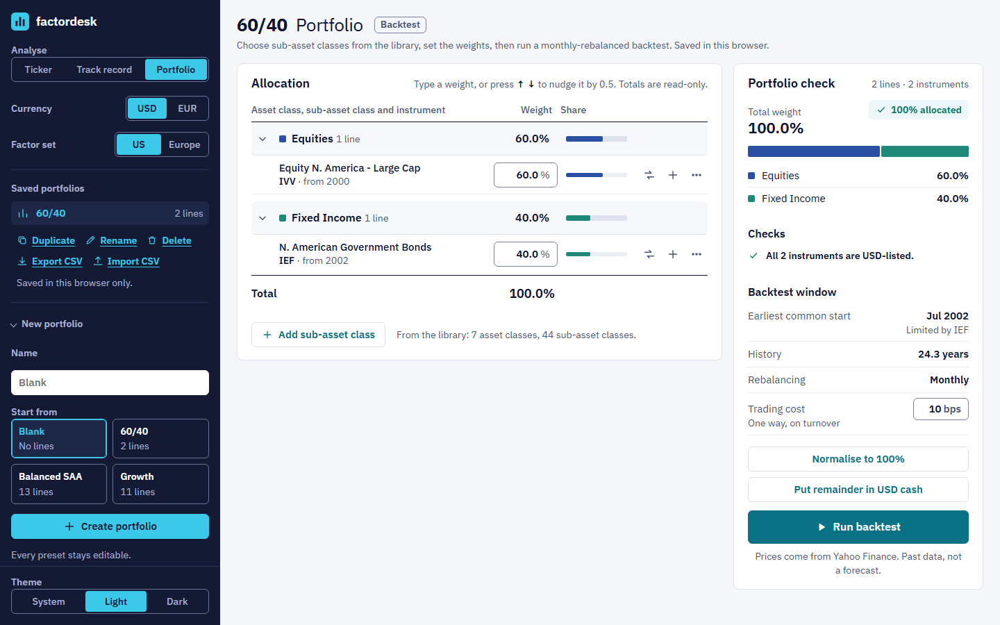
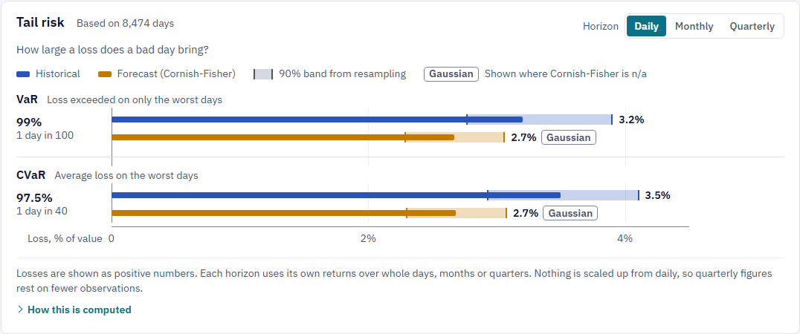
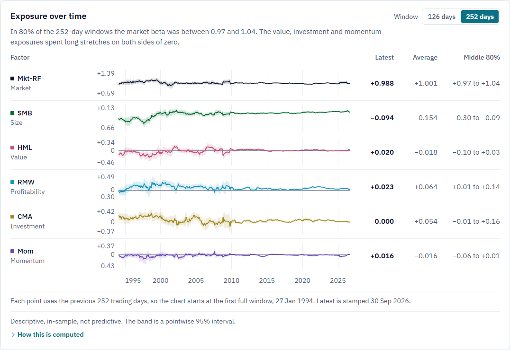
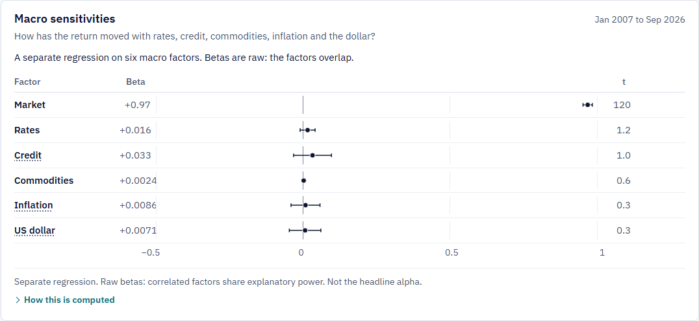

<h1 align="center">factordesk</h1>

<p align="center">
  <b>Fama-French factor analysis for stocks, ETFs, fund track records and portfolios.</b><br>
  See what drives the returns, in plain language, on your own machine.
</p>

<p align="center">
  <a href="https://github.com/lbsm2017/factordesk/stargazers"></a>
  <a href="LICENSE"></a>
  
  
  
  <a href="#contributing"></a>
</p>

<p align="center">
  <a href="#quick-start">Quick start</a> ·
  <a href="#what-you-can-do-with-it">What you can do</a> ·
  <a href="wiki/guide-dashboard.md">Dashboard tour</a> ·
  <a href="#documentation">Documentation</a> ·
  <a href="#faq">FAQ</a> ·
  <a href="#contributing">Contributing</a>
</p>

<p align="center">
  <picture>
    <source media="(prefers-color-scheme: dark)" srcset="docs/images/dark-theme.png">
    
  </picture>
</p>

Type a ticker and press **Factor it**. factordesk downloads the prices and the public Ken French
factor data, runs the factor regression, and tells you in one sentence what the stock, fund or
portfolio really is: how much is the market, how much is size, value, profitability, investment
and momentum, and whether anything is left that looks like alpha.

```bash
git clone https://github.com/lbsm2017/factordesk.git && cd factordesk
uv sync
uv run factordesk report SPY --open     # a full factor report in your browser
```

No account, no API key and no cloud: it runs locally and uses free public data.

If factordesk is useful to you, please **star the repository**. Stars are how other people find
it.

<sub>Screenshots in this README show SPY, IEUR and a 60/40 portfolio of ETFs, taken on 20 Nov 2026
from a local run. Prices come from Yahoo Finance and are shown for illustration only; no price data
is stored in this repository. Created by <b>Lorenzo Bassetti</b>. Free for personal and other
noncommercial use; commercial use needs consent (<a href="#can-i-use-it">Can I use it?</a>).</sub>

## Why factordesk

- **It answers in plain language.** Every page opens with a verdict sentence, and every number
  carries a one-word reading: clear evidence, could be noise, or probably biased. The regression
  table is one switch away when you want it.
- **It is honest about uncertainty.** Robust (Newey-West) standard errors, a correction for testing
  several factors at once, and checks that use only the data known on each day, so a result that
  needs hindsight is shown as such.
- **It runs on your machine.** No account, no API key, no upload to anyone's server. Your portfolio
  weights and any track record you upload never leave your computer.
- **It covers more than one stock.** Tickers, uploaded track records and whole portfolios; US
  dollars or euros; US or Developed Europe factors.
- **It shows its sources.** Every method is documented with its reference, every data file with its
  date and origin, and every caveat that applies is printed on the page.
- **It is tested.** More than 2,800 automated tests, an independent recomputation of the reference
  report, and a written methodology you can check the code against.

factordesk describes the past. It does not forecast, rank or recommend anything.

## What you can do with it

| You want to | factordesk gives you |
| --- | --- |
| **Know what a stock or ETF really is** | Its factor exposures (market beta, size, value, profitability, investment, momentum) with confidence intervals. Is that "quality" ETF more than the market plus a profitability tilt? |
| **Test a fund manager's alpha** | Upload the monthly track record of a mutual fund or hedge fund and see the alpha under CAPM and the Fama-French three-, five- and six-factor models, side by side. |
| **X-ray a portfolio or an asset allocation** | Build a 60/40 or a multi-asset portfolio, backtest it with monthly rebalancing, and see which holdings and which factors carry the return and the risk. |
| **Measure risk** | Volatility, Sharpe ratio, maximum drawdown, value at risk (VaR) and expected shortfall (CVaR), with risk attribution by factor. |
| **See the macro sensitivities** | Exposure to interest rates, credit, inflation, commodities, the US dollar, oil, natural gas and carbon prices. |
| **Check whether exposures are stable** | Rolling betas, Kalman-filter betas and betas adjusted for noise, all without look-ahead. |
| **Work in euros** | A euro view with daily ECB exchange rates, euro cash rates and the Developed Europe factor set. |
| **Learn or teach factor investing** | A worked example of empirical asset pricing: every statistic is explained, sourced and reproducible. |

<table>
  <tr>
    <td width="50%" valign="top">
      <a href="wiki/guide-dashboard.md#factor-exposures"></a><br>
      <b>Factor exposures.</b> Which factors move it, and which betas are statistically significant.
    </td>
    <td width="50%" valign="top">
      <a href="wiki/guide-dashboard.md#return-and-risk-sources"></a><br>
      <b>Return and risk attribution.</b> Where the return and the variance came from, adding up exactly.
    </td>
  </tr>
  <tr>
    <td width="50%" valign="top">
      <a href="wiki/guide-dashboard.md#portfolio-mode"></a><br>
      <b>Portfolio composer and backtest.</b> Asset classes, proxy ETFs, presets and CSV import.
    </td>
    <td width="50%" valign="top">
      <a href="wiki/guide-dashboard.md#tail-risk"></a><br>
      <b>Tail risk.</b> VaR and CVaR, historical and forecast, daily to quarterly.
    </td>
  </tr>
  <tr>
    <td width="50%" valign="top">
      <a href="wiki/guide-dashboard.md#exposure-over-time"></a><br>
      <b>Betas over time.</b> Rolling and Kalman-filter betas that use only past data.
    </td>
    <td width="50%" valign="top">
      <a href="wiki/guide-dashboard.md#macro-sensitivities-and-energy"></a><br>
      <b>Macro sensitivities.</b> Rates, credit, inflation, the dollar, oil, gas and carbon.
    </td>
  </tr>
</table>

Every panel, control and mode is shown in the [dashboard tour](wiki/guide-dashboard.md).

## Quick start

You need [uv](https://docs.astral.sh/uv/), which installs Python for you. The interactive dashboard
also needs Node 26 or newer with npm 12 or newer, to build the page once.

```bash
git clone https://github.com/lbsm2017/factordesk.git
cd factordesk
uv sync                # Python and every dependency, pinned
uv run poe setup       # once: build the dashboard page
uv run poe serve       # start it and open http://127.0.0.1:8000
```

Type a ticker such as `SPY`, `AAPL` or `NESN.SW` and press **Factor it**. For a one-file report
with no Node needed, run `uv run factordesk report SPY --open`.

The first run downloads the factor files and the ticker's price history and caches them in
`data/`, so later runs are fast. How to install uv on each system, every shortcut, command-line
option and API route, and what to do when something fails are in
[Install and use factordesk](wiki/guide-install-and-use.md).

## How it works

1. **Data.** Daily prices from Yahoo Finance, factor returns from the Kenneth R. French Data
   Library, exchange and cash rates from the ECB, FRED and the Swiss National Bank. All cached on
   your machine.
2. **Audit.** Splits and distributions are checked, and a quality gate flags closing prices that
   are out of step with the factor data.
3. **Analysis.** Ordinary least squares on the Fama-French five factors plus momentum, with
   Newey-West errors and a Benjamini-Hochberg correction; then attribution, rolling and Kalman
   betas, tail risk and the rest, without look-ahead where it matters.
4. **Report.** One typed report feeds both the dashboard and the offline HTML file.

The pipeline diagram, the method, the checks behind the numbers and the known limits are in
[How factordesk works](wiki/guide-how-it-works.md). The binding statistical rules are in
[docs/methodology.md](docs/methodology.md).

## Documentation

| Guide | What it covers |
| --- | --- |
| [Install and use](wiki/guide-install-and-use.md) | Installation, shortcuts, the dashboard and report commands, the API, exit codes |
| [Dashboard tour](wiki/guide-dashboard.md) | Every panel, control and mode, with screenshots |
| [How it works](wiki/guide-how-it-works.md) | Pipeline, method, scientific rigour, limitations, key references |
| [Data sources and their terms](wiki/guide-data-sources.md) | Where each number comes from and the terms that apply |
| [Developing factordesk](wiki/guide-development.md) | Code layout, tests and quality checks, status and roadmap |
| [Glossary](wiki/glossary.md) | Alpha, beta, HAC errors, point-in-time and the rest, in plain English |
| [Decisions](wiki/index.md) | Every design decision: what, why and what it cost |
| [Technical documents](wiki/index.md#technical-documents) | Methodology, research protocol, specs, reviews, validation, sprints and roadmap in `docs/` |

## Contributing

Contributions are welcome, from a one-line fix to a new factor region. You do not need to be a
quant: testers, front-end developers, technical writers and people who simply doubt a number are
all useful here.

```bash
git clone https://github.com/lbsm2017/factordesk.git && cd factordesk
uv sync                # Python and every dependency, pinned
uv run poe setup       # build the dashboard page
uv run poe test        # the fast test suite, offline
```

Branch from `dev`, make your change, and open a pull request against `dev`.
[CONTRIBUTING.md](CONTRIBUTING.md) has the rules in full.

| If you like | You could |
| --- | --- |
| Testing | Try the dashboard in Firefox or Safari, or with a screen reader, and report what breaks. None of these is verified yet. |
| Statistics | Challenge a number. Pick a ticker, recompute a statistic your own way, and open an issue if it disagrees. Method errors are as valuable as code bugs. |
| Python | Add currency, factor-set and model options to the command line, which today covers US-dollar tickers only. |
| Data | Add a Ken French region (Japan, Asia Pacific, North America, Emerging Markets) next to the US and Developed Europe factor sets. |
| Front end | Bring the offline HTML report up to the dashboard's design, or improve a chart. |
| Writing | Fix or clarify the docs, the glossary or this README. If something confused you, it will confuse others. |

More ideas are in the [roadmap](wiki/guide-development.md#status-and-roadmap) and in the issues
labelled [`good first issue`](https://github.com/lbsm2017/factordesk/labels/good%20first%20issue)
and [`help wanted`](https://github.com/lbsm2017/factordesk/labels/help%20wanted). Not sure where to
begin? Open an issue and ask.

Every new statistic needs a test with a known answer and an entry in the methodology, because the
project's promise is that its numbers can be checked. Contributions are accepted under the
[contribution terms](CONTRIBUTING.md#license): your work is released under the project licence,
and you let the author license it commercially as well.

## FAQ

### What is a Fama-French factor analysis?

It is a regression of an investment's returns on a small set of published "factors": the market,
company size (SMB), value (HML), profitability (RMW), investment (CMA) and momentum (MOM). The
result says how much of the return is explained by exposure to each factor (the betas) and how
much is left over (the alpha). The factors come from the research of Eugene Fama and Kenneth
French, and the data from the Kenneth R. French Data Library. The [glossary](wiki/glossary.md)
defines every term in plain English.

### Is factordesk free?

Yes, for personal and other noncommercial use: your own study, research and savings, and use by
schools, universities and charities. Companies, professional advisers and investment organisations
need the author's consent first. See [Can I use it?](#can-i-use-it)

### Do I need an account, an API key or a paid data subscription?

No. factordesk uses free public sources: Yahoo Finance for prices (through yfinance), the Kenneth
R. French Data Library for factors, and FRED, the ECB and the Swiss National Bank for rates and
macro series. Each source keeps its own terms; Yahoo's allow personal use only. See
[Data sources and their terms](wiki/guide-data-sources.md).

### Does it work for European stocks, and in euros?

Yes. Tickers listed in EUR, GBP, CHF, SEK, NOK, DKK and five other currencies are accepted in the
dashboard, results can be shown in euros, and you can switch from the US factors to the Ken French
Developed Europe factors.

### Can I analyse a mutual fund, a hedge fund or my own portfolio?

Yes. A fund that has a Yahoo Finance ticker works like a stock. For any other fund or strategy,
upload its monthly returns as a CSV file in
[track record mode](wiki/guide-dashboard.md#track-record-mode). For a portfolio, build the
allocation in [portfolio mode](wiki/guide-dashboard.md#portfolio-mode) and run a backtest.

### How is it different from a backtester or a portfolio optimiser?

A backtester asks "what would this strategy have returned?" and an optimiser asks "which weights
are best?". factordesk asks "what is this thing exposed to, and is its alpha real?". It has a
simple monthly-rebalanced backtest so a portfolio can be analysed, but it does not search for
strategies, forecast returns or suggest weights.

### Can I trust the numbers?

Check them. The statistical rules are written down in [docs/methodology.md](docs/methodology.md),
every method cites its paper, the test suite compares results with known answers, and the
reference report was recomputed independently ([docs/validation/](docs/validation)). The known
weak points are listed under [Limitations](wiki/guide-how-it-works.md#limitations). If you find a
number you cannot reproduce, please open an issue.

### Is my data private?

Yes. The server listens on your own machine only (`127.0.0.1`). Uploaded track records are kept
in memory and never written to disk, portfolios are saved in your browser, and the only network
traffic is the download of public prices, factors and rates.

### Is this investment advice?

No. See [Not financial advice](#not-financial-advice).

## Can I use it?

factordesk is source-available under the
[factordesk Noncommercial License 1.0](LICENSE). It is not an open-source licence: you may read,
run, change and share the code for noncommercial purposes, and you need consent for anything
else.

| You are | Use |
| --- | --- |
| A person using it for your own study, research or savings | Free |
| A student, teacher or researcher at a school, university or public research organisation | Free |
| A charity or other noncommercial organisation, outside investment management | Free |
| A company, a professional adviser, or anyone using it for paid work or a product | Ask first |
| A bank, asset manager, pension fund, sovereign wealth fund, endowment, insurer or central bank, or anyone managing or advising on investments for an organisation | Ask first |
| A government institution (other than a school, university or public research organisation) | Ask first |

In every case, keep the licence and the copyright notice with any copy you share, and please
[cite factordesk](#author-citation-licence) if you use it in published work.

**Commercial use.** Write to Lorenzo Bassetti at <lorenzo.bassetti@gmail.com> to ask for consent
or a commercial licence. A commercial licence covers the code only: the data factordesk downloads
stays under each provider's terms ([Data sources and their terms](wiki/guide-data-sources.md)).

This table is a plain summary. The [LICENSE](LICENSE) file is the text that counts.

## Author, citation, licence

factordesk was created by **Lorenzo Bassetti** ([@lbsm2017](https://github.com/lbsm2017)) and is
maintained with the factordesk contributors.

- **Licence.** The code is under the [factordesk Noncommercial License 1.0](LICENSE), copyright
  2026 Lorenzo Bassetti and factordesk contributors: free for noncommercial use, commercial use by
  written consent ([decision](wiki/decision-noncommercial-license.md)). The fonts are under the SIL
  Open Font License; these and the libraries bundled into the dashboard page are listed in
  [THIRD_PARTY_NOTICES.md](THIRD_PARTY_NOTICES.md).
- **Citation.** [CITATION.cff](CITATION.cff) holds the citation for factordesk itself (GitHub:
  "Cite this repository"). Please also credit Eugene F. Fama and Kenneth R. French for the factor
  data. The papers behind each method are in the
  [key references](wiki/guide-how-it-works.md#key-references). López de Prado (2023), *Causal
  Factor Investing* ([doi](https://doi.org/10.1017/9781009397315)), is cited as a source for
  scientific rigour; none of factordesk's algorithms are taken from it.
- **Security.** [SECURITY.md](SECURITY.md) says how to report a vulnerability privately.

## Not financial advice

factordesk is a research and education tool. Its output describes how past returns related to
published factors. It is not investment, tax or legal advice, and it is not a recommendation to buy
or sell anything. Past exposures may not persist.
