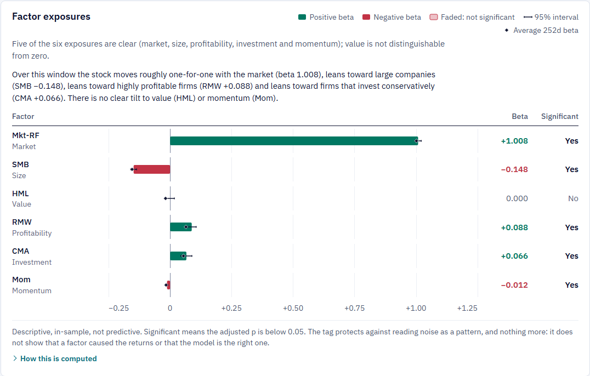
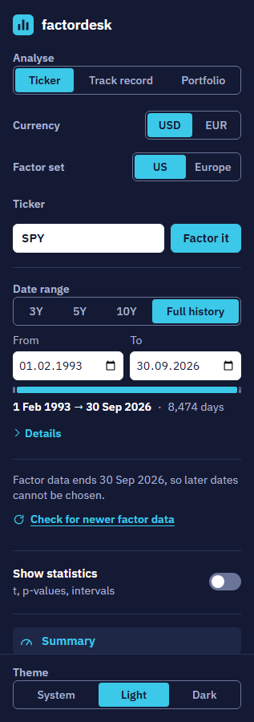
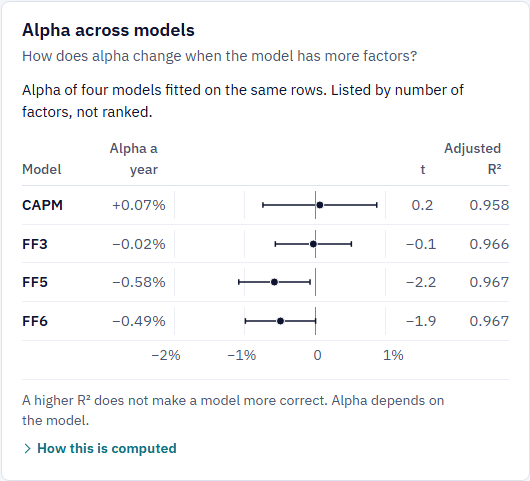
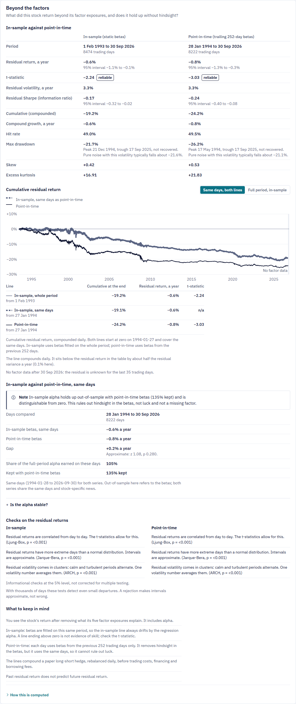
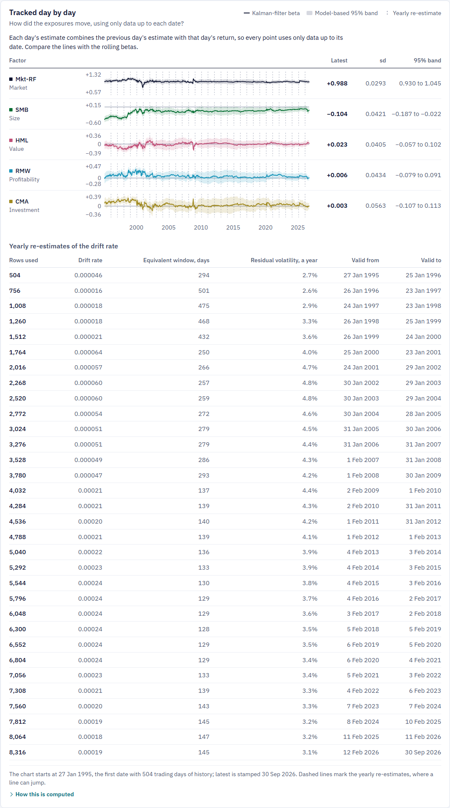
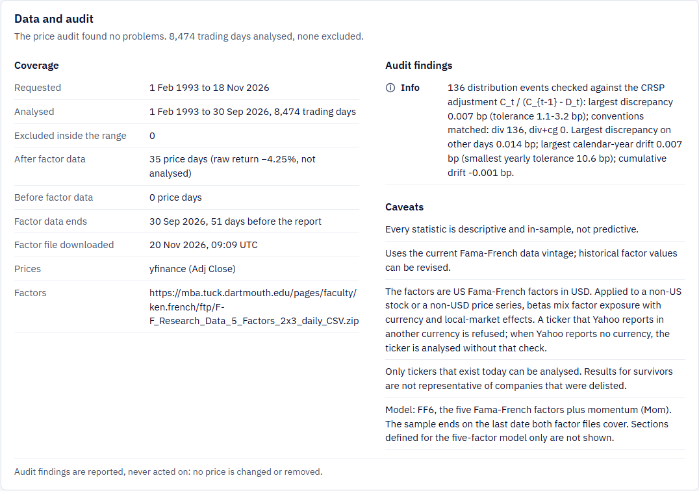
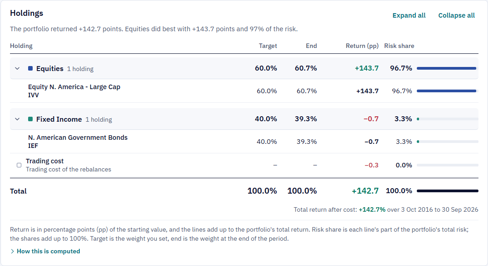
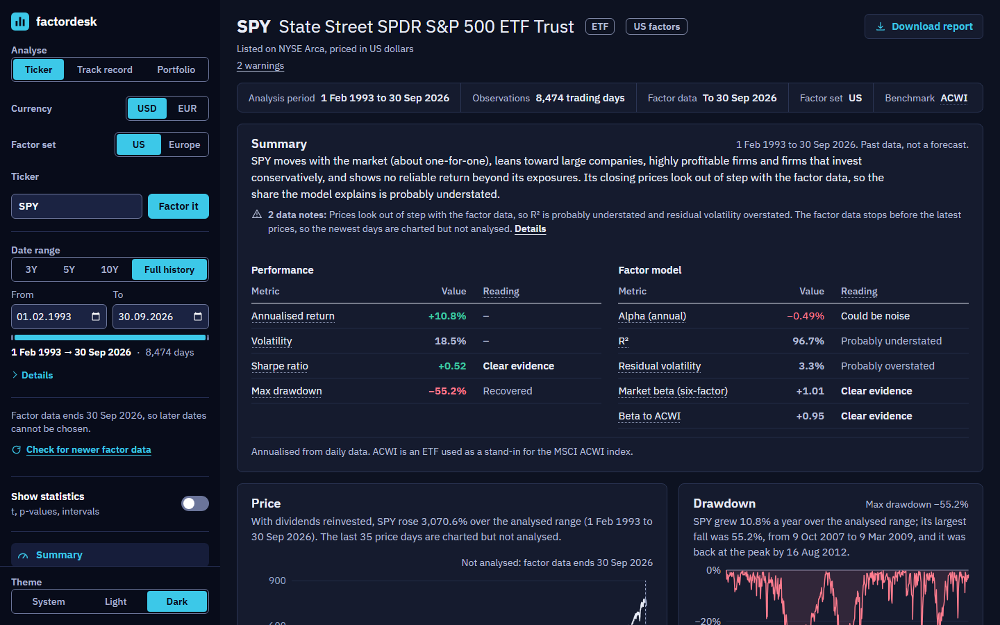
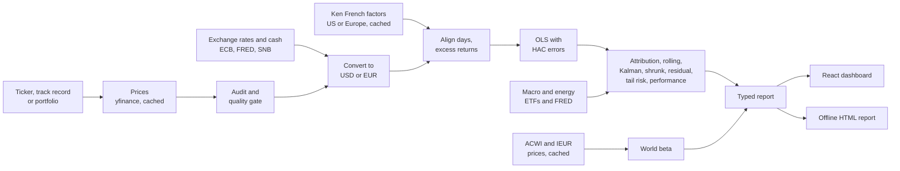

<h1 align="center">factordesk</h1>

<p align="center">
  <b>Fama-French factor analysis for stocks, ETFs, fund track records and portfolios.</b><br>
  See what drives the returns, in plain language, on your own machine.
</p>

<p align="center">
  <a href="https://github.com/lbsm2017/factordesk/stargazers"></a>
  <a href="LICENSE"></a>
  
  
  
  <a href="#contributing"></a>
</p>

<p align="center">
  <a href="#quick-start">Quick start</a> ·
  <a href="#what-you-can-do-with-it">What you can do</a> ·
  <a href="#a-tour-of-the-dashboard">Screenshots</a> ·
  <a href="#method">Method</a> ·
  <a href="#faq">FAQ</a> ·
  <a href="#contributing">Contributing</a>
</p>

<p align="center">
  <picture>
    <source media="(prefers-color-scheme: dark)" srcset="docs/images/dark-theme.png">
    
  </picture>
</p>

Type a ticker and press **Factor it**. factordesk downloads the prices and the public Ken French
factor data, runs the factor regression, and tells you in one sentence what the stock, fund or
portfolio really is: how much is the market, how much is size, value, profitability, investment
and momentum, and whether anything is left that looks like alpha.

```bash
git clone https://github.com/lbsm2017/factordesk.git && cd factordesk
uv sync
uv run factordesk report SPY --open     # a full factor report in your browser
```

No account, no API key and no cloud: it runs locally and uses free public data.
[Full quick start](#quick-start), with the interactive dashboard, is below.

If factordesk is useful to you, please **star the repository**. Stars are how other people find
it.

<sub>Screenshots in this README show SPY, IEUR and a 60/40 portfolio of ETFs, taken on 20 Nov 2026
from a local run. Prices come from Yahoo Finance and are shown for illustration only; no price data
is stored in this repository. Created by <b>Lorenzo Bassetti</b>. Free for personal and other
noncommercial use; commercial use needs consent (<a href="#can-i-use-it">Can I use it?</a>).</sub>

## Contents

- [Why factordesk](#why-factordesk)
- [What you can do with it](#what-you-can-do-with-it)
- [Features](#features)
- [Quick start](#quick-start)
- [A tour of the dashboard](#a-tour-of-the-dashboard)
- [How it works](#how-it-works)
- [Method](#method)
- [Scientific rigour](#scientific-rigour)
- [Installation](#installation)
- [Usage](#usage)
- [Project layout](#project-layout)
- [Tests and quality checks](#tests-and-quality-checks)
- [Data sources and licences](#data-sources-and-licences)
- [Limitations](#limitations)
- [Status and roadmap](#status-and-roadmap)
- [Contributing](#contributing)
- [FAQ](#faq)
- [Can I use it?](#can-i-use-it)
- [Documentation map](#documentation-map)
- [Key references](#key-references)
- [Author, citation, licence](#author-citation-licence)

## Why factordesk

- **It answers in plain language.** Every page opens with a verdict sentence, and every number
  carries a one-word reading: clear evidence, could be noise, or probably biased. The regression
  table is one switch away when you want it.
- **It is honest about uncertainty.** Robust (Newey-West) standard errors, a correction for testing
  several factors at once, and checks that use only the data known on each day, so a result that
  needs hindsight is shown as such.
- **It runs on your machine.** No account, no API key, no upload to anyone's server. Your portfolio
  weights and any track record you upload never leave your computer.
- **It covers more than one stock.** Tickers, uploaded track records and whole portfolios; US
  dollars or euros; US or Developed Europe factors.
- **It shows its sources.** Every method is documented with its reference, every data file with its
  date and origin, and every caveat that applies is printed on the page.
- **It is tested.** More than 2,800 automated tests, an independent recomputation of the reference
  report, and a written methodology you can check the code against.

factordesk describes the past. It does not forecast, rank or recommend anything.

## What you can do with it

| You want to | factordesk gives you |
| --- | --- |
| **Know what a stock or ETF really is** | Its factor exposures (market beta, size, value, profitability, investment, momentum) with confidence intervals. Is that "quality" ETF more than the market plus a profitability tilt? |
| **Test a fund manager's alpha** | Upload the monthly track record of a mutual fund or hedge fund and see the alpha under CAPM and the Fama-French three-, five- and six-factor models, side by side. |
| **X-ray a portfolio or an asset allocation** | Build a 60/40 or a multi-asset portfolio, backtest it with monthly rebalancing, and see which holdings and which factors carry the return and the risk. |
| **Measure risk** | Volatility, Sharpe ratio, maximum drawdown, value at risk (VaR) and expected shortfall (CVaR), with risk attribution by factor. |
| **See the macro sensitivities** | Exposure to interest rates, credit, inflation, commodities, the US dollar, oil, natural gas and carbon prices. |
| **Check whether exposures are stable** | Rolling betas, Kalman-filter betas and betas adjusted for noise, all without look-ahead. |
| **Work in euros** | A euro view with daily ECB exchange rates, euro cash rates and the Developed Europe factor set. |
| **Learn or teach factor investing** | A worked example of empirical asset pricing: every statistic is explained, sourced and reproducible. |

<table>
  <tr>
    <td width="50%" valign="top">
      <a href="#factor-exposures"></a><br>
      <b>Factor exposures.</b> Which factors move it, and which betas are statistically significant.
    </td>
    <td width="50%" valign="top">
      <a href="#return-and-risk-sources"></a><br>
      <b>Return and risk attribution.</b> Where the return and the variance came from, adding up exactly.
    </td>
  </tr>
  <tr>
    <td width="50%" valign="top">
      <a href="#portfolio-mode"></a><br>
      <b>Portfolio composer and backtest.</b> Asset classes, proxy ETFs, presets and CSV import.
    </td>
    <td width="50%" valign="top">
      <a href="#tail-risk"></a><br>
      <b>Tail risk.</b> VaR and CVaR, historical and forecast, daily to quarterly.
    </td>
  </tr>
  <tr>
    <td width="50%" valign="top">
      <a href="#exposure-over-time"></a><br>
      <b>Betas over time.</b> Rolling and Kalman-filter betas that use only past data.
    </td>
    <td width="50%" valign="top">
      <a href="#macro-sensitivities-and-energy"></a><br>
      <b>Macro sensitivities.</b> Rates, credit, inflation, the dollar, oil, gas and carbon.
    </td>
  </tr>
</table>

## Features

- **Verdict first.** Every page opens with one plain sentence on what the stock, record or
  portfolio does, then two short tables (Performance and Factor model) with a one-word reading for
  each number. Every panel then opens with its own result sentence.
- **Statistics on demand.** A **Show statistics** switch reveals t-statistics, p-values and
  intervals. With it off, the page reads like a research note; with it on, like a regression table.
- **Three modes.** Analyse a **Ticker**, an uploaded **Track record** (monthly CSV) or a
  **Portfolio** built in the composer.
- **Portfolio composer.** A tree of asset classes from a 44-line library with a proxy ETF on each
  line, four presets (Blank, 60/40, Balanced SAA, Growth), CSV import and export, and a backtest
  with monthly rebalancing and trading costs. The Holdings panel shows each line's return
  contribution and risk share.
- **USD or EUR.** Every report can be shown in US dollars or euros. Listings in 11 currencies are
  converted daily at ECB rates; cash earns the T-bill rate in USD and €STR in EUR; US bond lines are
  hedged in the euro view.
- **US or Europe factors.** The US five factors plus momentum, or the Ken French Developed Europe
  set.
- **Careful inference.** Newey-West (HAC) standard errors, Benjamini-Hochberg correction across the
  betas, and return and risk attribution that adds up exactly to the total.
- **Alpha across models.** Alpha under CAPM, the three-, five- and six-factor models side by side,
  so you see how much of it the extra factors explain.
- **Tail risk.** Value at risk and expected shortfall at 95% and 99%, historical and forecast, with
  bootstrap bands, at a daily, monthly or quarterly horizon.
- **Macro, energy and carbon.** Sensitivities to rates, credit, commodities, inflation and the US
  dollar, and to Brent oil, US natural gas and carbon allowances.
- **World beta.** A quick single-factor beta against world stocks (ACWI) and Europe (IEUR), each
  compared with the US market beta on the same days.
- **Betas over time.** Rolling betas (126 or 252 days), Kalman-filter betas that use only past
  data, and betas adjusted for noise.
- **Audit trail.** A data-and-audit panel lists coverage, excluded days, the factor file's date and
  source, every audit finding and every caveat that applies.
- **Shows its work.** **Factor it** shows each step as it runs (prices, exchange rates, factors,
  models, sections), and the page fills in panel by panel.
- **Light or dark.** A System, Light and Dark theme switch.
- **Local and private.** The server listens on `127.0.0.1`, has no login and contacts nothing but
  the public data sources. Uploaded files stay in memory and are never written to disk.
- **Offline export.** One self-contained HTML report per ticker, from the dashboard or the command
  line.

## Quick start

You need [uv](https://docs.astral.sh/uv/), which installs Python for you. The interactive dashboard
also needs Node 26 or newer with npm 12 or newer, to build the page once.

**1. Get the code**

```bash
git clone https://github.com/lbsm2017/factordesk.git
cd factordesk
uv sync                # Python and every dependency, pinned
```

**2. Open the dashboard**

```bash
uv run poe setup       # once: build the dashboard page
uv run poe serve       # start it and open http://127.0.0.1:8000
```

Type a ticker such as `SPY`, `AAPL` or `NESN.SW` and press **Factor it**.

**Or write a one-file report, with no Node needed**

```bash
uv run factordesk report SPY --open      # writes SPY_report.html and opens it
```

If you have make, `make setup` and `make serve` do the same; every command is listed under
[Shortcuts](#shortcuts). The first run downloads the factor files and the ticker's price history.
Both are cached in `data/`, so later runs are fast. Step-by-step instructions for each system are
under [Installation](#installation).

## A tour of the dashboard

The page has a sidebar with the controls and a section list, and a content area with one panel per
question. The URL holds the state, so a link reopens the same view.

### Sidebar



- **Analyse.** Choose **Ticker**, **Track record** or **Portfolio**.
- **Ticker.** Any Yahoo Finance symbol (`AAPL`, `SPY`, `BRK-B`, `NESN.SW`). Tickers you have
  already analysed are suggested as you type, with their company name.
- **Date range.** 3Y, 5Y, 10Y (the default) or Full history, or your own From and To dates. A preset
  is disabled when the history is too short, with the reason.
- **Currency.** **USD** or **EUR**. Your last choice is remembered.
- **Factor set.** **US** or **Europe** (Developed Europe five factors plus momentum). Macro, energy
  and world beta always use their US inputs.
- **Factor data.** The date the factor file ends, and **Check for newer factor data**. The Ken
  French library publishes with a lag of a month or more, so the newest prices are charted but not
  analysed; the sidebar says how many days that is.
- **Show statistics.** Adds t-statistics, p-values and intervals to every panel.
- **Theme.** System, Light or Dark.
- **Section list.** Jumps to a panel and highlights the one you are reading.

<br clear="right">

The URL parameters are:

| Parameter | Values | Default when missing |
| --- | --- | --- |
| `t` | a ticker | none |
| `m` | `track` or `portfolio` | ticker mode |
| `range` | `3Y`, `5Y`, `10Y`, `FULL`, or `start` and `end` as `YYYY-MM-DD` | `10Y` |
| `model` | `ff5` or `ff6` | `ff6` (five factors plus momentum) |
| `ccy` | `USD` or `EUR` | your last choice, else USD |
| `fs` | `europe` | the US factors |
| `stats` | `1` | statistics hidden |

For example, `http://127.0.0.1:8000/?t=AAPL&range=5Y&ccy=EUR&stats=1` opens Apple over five years
in euros with the statistics shown.

### Header

The header gives the name, exchange, currency and security type, a link to any warnings, the
analysis period, the number of days, the factor data's end date and the benchmark. Pills show
**Figures in EUR** and **US factors** or **Europe factors**. **What EUR changes** opens a short
explanation of how the euro view converts returns, cash and hedged lines. **Download report** saves
the analysis as an offline HTML file (ticker mode, USD).

### Summary

The verdict in one paragraph, then two tables. *Performance* shows annualised return, volatility,
Sharpe ratio and maximum drawdown. *Factor model* shows alpha, R², residual volatility, the market
beta and the beta to world stocks. The *Reading* column says whether each number is clear evidence,
could be noise, or is probably biased. For example, R² is flagged as probably understated when the
closing prices are out of step with the factor data. Data notes sit directly under the verdict.

### Price and drawdown


**Price** shows the adjusted close over the range, with the days after the factor data marked as
"not analysed". **Drawdown** shows how far the price stood below its previous peak on each day, the
largest fall with its peak, low and recovery dates, and a table of the five largest falls. Signed
returns are green when positive and red when negative.

### Factor exposures


The core of the analysis. Each bar is a full-sample beta: how much the excess return moved with one
factor, holding the others fixed.

| Factor | Plain name | A positive beta means | A negative beta means |
| --- | --- | --- | --- |
| Mkt-RF | Market | moves with the market (1.0 is one-for-one) | moves against the market |
| SMB | Size | leans toward small companies | leans toward large companies |
| HML | Value | leans toward value stocks | leans toward growth stocks |
| RMW | Profitability | leans toward highly profitable firms | leans toward weakly profitable firms |
| CMA | Investment | leans toward firms that invest conservatively | leans toward firms that invest aggressively |
| MOM | Momentum (six-factor model only) | leans toward recent winners | leans toward recent losers |

Bars above zero are green and bars below zero red. A faded bar is not significant: its
Benjamini-Hochberg adjusted p-value is 0.05 or more, so the beta cannot be told apart from zero. The
whisker is the 95% interval and the diamond is the average rolling beta. With **Show statistics**
on, the table adds the t-statistic and the average rolling beta:


### Alpha across models



Alpha under CAPM, the three-factor, five-factor and six-factor models on the same days. An alpha
that shrinks as factors are added was a factor exposure, not skill.

### World beta


A quick single-factor check outside the US factor set: the beta against the iShares MSCI ACWI ETF
(a stand-in for the MSCI All Country World index) and the iShares Core MSCI Europe ETF (IEUR). Each
is shown next to a one-factor US market beta on exactly the same days, and the panel says whether
the two differ.

### Return and risk sources


**Return sources** splits the average annual excess return into the part each factor explains
(beta times the factor's average return), alpha, and a residual that is zero by construction. The
rows add up exactly to the total. **Risk sources** splits the variance into factor shares and a
specific (idiosyncratic) share. Shares add to 100% and can be negative when one factor offsets the
others.

### Tail risk


Value at risk (VaR) at 95% and 99%, and expected shortfall (CVaR) at 95% and 97.5%. Each figure has
a **Historical** bar (from the observed returns) and a **Forecast** bar (Cornish-Fisher, which
allows for skew and fat tails, or Gaussian when Cornish-Fisher does not apply) on one shared scale,
each with a 90% bootstrap band. Switch the horizon between **Daily**, **Monthly** and
**Quarterly**. A forecast is flagged as indicative when the Cornish-Fisher curve is not reliable
or its bootstrap band is wide. **How this is computed** gives
the details.

### Macro sensitivities and energy


**Macro sensitivities** regress the excess return on the market and five macro legs built from
ETFs and FRED: rates (IEF minus cash), credit (LQD minus IEF), commodities (DBC minus cash),
inflation (TIP minus IEI) and the US dollar (the Federal Reserve's broad dollar index). Each row
shows a variance inflation factor (VIF) so you can see when two legs overlap.


**Energy & carbon** regresses on the market plus Brent crude and Henry Hub natural gas, and, from
August 2020, a carbon model with the KRBN carbon allowance ETF (it needs at least two years). The
gas fit is repeated without its five largest moves so one spike cannot drive the result.

### Exposure over time


Rolling betas over the previous 126 or 252 trading days, with a pointwise 95% band. Each point uses
only past data. The table gives the latest value, the average and the range that holds the middle
80% of windows, and the result sentence says whether an exposure stayed stable or crossed zero.

### Deeper checks (five-factor model)

These panels test the headline numbers. They are built on the five-factor model, so they appear
when the model is FF5 (`model=ff5` in the URL); under the default six-factor model they are left
out.

**Beyond the factors** (residual alpha) compares the residual return under full-sample betas
(in-sample) with the residual under trailing 252-day betas known on each day (point-in-time). A
residual return that is only significant in-sample relied on hindsight. The panel reports the
residual return with its interval, volatility, information ratio, cumulative and compound growth,
hit rate, drawdown compared with what pure noise would give, skew and kurtosis.



**Tracked day by day** (Kalman betas) lets each beta drift slowly and updates it with each day's
return, so every point uses only data up to its date. The drift rate is re-estimated once a year
and shown with its equivalent rolling window.



**Adjusted for noise** (shrunk betas) pulls each beta toward a prior in proportion to its
uncertainty (Vasicek), shows how far each one moved, and states the smallest effect the data could
have detected.

### Data and audit



Coverage of the request, the days analysed and excluded, the factor file's end date, download time
and source URL, every audit finding (for example the check of distribution adjustments against the
CRSP convention) and every caveat that applies. Audit findings are reported, never acted on: no
price is changed or removed. A **Regression detail** panel at the end of the page holds the full
regression table and the residual diagnostics.

### Track record mode


Drop a CSV file of monthly returns, or choose one. The file has a header row and two columns:

```text
date,return
2020-01-31,0.012
2020-02-29,-0.034
```

A date is `YYYY-MM-DD` or `YYYY-MM` and is moved to the month end; a return is a decimal (`0.012`
is 1.2%). Say whether the returns are **Gross**, **Net** or **Not stated**, and whether the record
is in **USD** or **EUR**. The file can be up to 1 MB, is held in memory only and is never written
to disk. The report uses monthly factors and has the same panels as a ticker where monthly data
allows; it has no **Download report** link.

### Portfolio mode


The composer has an allocation tree on the left and a live check panel on the right.

- **Build.** Start from **Blank**, **60/40**, **Balanced SAA** or **Growth**, or add lines from the
  library of 44 asset classes. Each line has a proxy ETF; lines without one are greyed ("No proxy
  yet"). Keep several named portfolios, rename them, delete them, and undo a delete.
- **Check.** The live panel shows the total, any unallocated weight (it goes to cash in the
  reference currency), and the trading cost in basis points. **Normalise to 100%** and **Put
  remainder in USD cash** fix the total in one click.
- **Share.** **Export CSV** and **Import CSV** round-trip a portfolio exactly; an import error names
  the line at fault.
- **Run backtest.** A monthly-rebalanced backtest of up to 50 instruments over the period they all
  trade, analysed with the six-factor model by default. In the euro view, lines are tagged
  "hedged to EUR", "not hedged: several currencies" or "USD cash, not hedged".

The portfolio report adds two panels. **Backtest** gives the window, the holdings that limit it,
the number of rebalances, the cost and the unallocated weight. **Holdings** gives each line's target
and end weight, return contribution and risk share, rolled up through the tree.



### The euro view and the Europe factors


With **Currency** on **EUR**, every price is converted to euros at the daily ECB reference rate,
cash earns €STR (EONIA before October 2019), and US bond lines in a portfolio are hedged to euros.
With **Factor set** on **Europe**, the regression uses the Ken French Developed Europe factors. The
two switches are independent.

### Dark theme



### On a phone


Under 900 px the sidebar becomes a top bar with a menu, and every panel stacks into one column. No
text is smaller than 14 px at any width.

## How it works



1. **Data.** Daily adjusted closes come from Yahoo Finance through yfinance, with one cached
   metadata read for the name, exchange and currency. Listings in USD, EUR, GBP (pence are divided
   by 100), CHF, JPY, CAD, AUD, HKD, SEK, NOK and DKK are accepted; other currencies are refused
   with a plain message. Exchange rates and euro cash rates come from the ECB, with FRED as a
   fallback; Swiss franc cash comes from SARON at the Swiss National Bank. The factor files come
   from the Kenneth R. French Data Library and are refreshed automatically once they are more than
   40 days old.
2. **Audit.** Distributions and splits are checked against the CRSP adjustment convention, extreme
   days are flagged, and a quality gate tests whether the closing prices are synchronous with the
   factor data.
3. **Analysis.** The excess return is regressed on the factors over the days where prices and
   factors overlap; every other section builds on that sample. Track records and portfolios use
   monthly data.
4. **Report.** The result is one typed report (`backend/factordesk/report/schema.py`, schema
   version 4). The dashboard and the offline HTML renderer both read it. Optional sections carry a
   status (ok, insufficient data, not applicable or failed), so one failing section never breaks the
   page.

The backend is a FastAPI server (`backend/factordesk/api/`). The page is React and TypeScript built
with Vite, with plain CSS tokens and ECharts for the line charts. The TypeScript types are generated
from the backend's OpenAPI schema, and CI fails if they drift.

## Method

The excess return is regressed by ordinary least squares on the Fama-French factors: the five
factors Mkt-RF, SMB, HML, RMW and CMA
([Fama and French 2015](https://doi.org/10.1016/j.jfineco.2014.10.010)), plus momentum (MOM) in the
six-factor model that the dashboard uses by default.

- **Inference.** Newey-West HAC standard errors, so autocorrelation and changing volatility do not
  overstate significance.
- **Multiple testing.** The betas are corrected together with Benjamini-Hochberg at 5%.
  "Significant" always means the adjusted p-value is below 0.05.
- **Attribution.** Return and risk attribution add up exactly to the totals.
- **No look-ahead where it matters.** Rolling, Kalman and point-in-time residual results use only
  data available on each day.
- **Performance.** Annualised from daily data; the Sharpe ratio interval follows Lo (2002) under an
  iid assumption.
- **Tail risk.** Historical and Cornish-Fisher VaR and CVaR with bootstrap bands.
- **Quality gate.** Flags closing prices that are not synchronous with the factor data, which
  biases R² down and residual volatility up.

The binding statistical rules are in [docs/methodology.md](docs/methodology.md) (M0 to M16); the
method in prose is in [docs/overview.md](docs/overview.md#method-in-detail).

## Scientific rigour

The [research protocol](docs/research-protocol.md) is the rule: write the hypothesis and the exact
test down before results, enter every run in an append-only
[test registry](docs/registry/tests.jsonl), correct for multiple tests, report power, and never use
data from after the date a result is stamped. The registry shows that the quality-gate threshold
was written after 13 inspection runs, so it is a documented heuristic and not a pre-registered
test; the protocol applies from then on.

Also in place:

- an independent recomputation of the SPY report, and mutation testing
  ([docs/validation/](docs/validation));
- an independent review of every analytics section before merge ([docs/reviews/](docs/reviews));
- real-data validation of the euro view and the Europe factors
  ([Sprint 3](docs/research/sprint-3-validation.md), [Sprint 4](docs/research/sprint-4-validation.md));
- a written [test oracle](docs/test-oracle.md) with tolerances;
- Monte Carlo tests of the Kalman filter at 200 replications (`uv run pytest -m slow`, run before
  each release);
- pinned lockfiles and fixed seeds;
- a bibliography where every source was checked ([docs/references.md](docs/references.md)).

## Installation

factordesk runs on Windows, macOS and Linux. The only prerequisite for the command line is
[uv](https://docs.astral.sh/uv/), which also installs a suitable Python (3.12 or newer). You do not
need a system Python, conda or make. The dashboard also needs Node 26 or newer and npm 12 or newer
to build the page once.

### 1. Install uv (once)

| System | Command |
| --- | --- |
| macOS, Linux | `curl -LsSf https://astral.sh/uv/install.sh \| sh` |
| Windows (PowerShell) | `powershell -ExecutionPolicy ByPass -c "irm https://astral.sh/uv/install.ps1 \| iex"` |
| Any (package managers) | `brew install uv` or `winget install --id=astral-sh.uv` |

### 2. Get the code and install dependencies

```bash
git clone https://github.com/lbsm2017/factordesk.git
cd factordesk
uv sync
```

`uv sync` creates a local `.venv`, installs the exact versions pinned in `uv.lock`, and downloads
Python 3.12 or newer if none is installed. Run it again after each `git pull`.

### 3. Check that it works

```bash
uv run factordesk --help
```

You should see the `report`, `factors` and `serve` commands. `uv run` runs a command inside the
project environment, so you never need to activate `.venv` yourself. Copy `.env.example` to `.env`
only if you need to override settings; `.env` is gitignored.

## Usage

Run all commands from the `factordesk` folder.

### Shortcuts

Common commands have short names. They run through uv, so they work the same on Windows, macOS and
Linux; `uv run poe` with no task lists them all. If you have make, the same shortcuts work as
`make <task>`.

| uv (every system) | make | What it does |
| --- | --- | --- |
| `uv run poe setup` | `make setup` | Install the page's dependencies and build the page (run `uv sync` first; `make setup` does it for you) |
| `uv run poe serve` | `make serve` | Start the dashboard on port 8000 and open it |
| `uv run poe serve --port 8080` | `make serve PORT=8080` | Start it on another port |
| `uv run poe stop` | `make stop` | Stop the dashboard on port 8000 (`--port` or `PORT=` for another port) |
| `uv run poe report SPY` | `make report T=SPY` | Write an offline report and open it |
| `uv run poe factors` | `make factors` | Show the cached factor file's range and age |
| `uv run poe refresh-factors` | `make refresh-factors` | Download the latest US factor file and the files behind the shrunk-beta prior |
| `uv run poe build` | `make build` | Rebuild the page after frontend changes |
| `uv run poe dev` | `make dev` | API with reload, for frontend work (run `npm --prefix frontend run dev` beside it) |
| `uv run poe test` | `make test` | Python and frontend unit tests |
| `uv run poe check` | `make check` | Lint, format and type checks, as CI runs them |
| `uv run poe e2e` | `make e2e` | Browser tests (Playwright) against a fake backend |
| `uv run poe ci` | `make ci` | Every CI gate: checks, tests, build, bundle size, browser tests |

`stop` only stops a factordesk server: it first checks that the port answers like factordesk, so it
never stops another program on that port.

### The dashboard

```bash
npm --prefix frontend ci            # once
npm --prefix frontend run build     # once, and again after pulling frontend changes
uv run factordesk serve --open
```

| Option | What it does |
| --- | --- |
| `--port PORT` | Port to listen on (default 8000). |
| `--host HOST` | Address to listen on (default `127.0.0.1`). Keep it local: the dashboard has no login, and a non-loopback address prints a warning. |
| `--open` | Open the dashboard in a browser once the server is ready. |
| `--dev` | API only, restarting on code changes; the page comes from the Vite dev server. |
| `--static DIR` | Serve the built page from another folder. |

`serve` warns when the built page is older than its source, so you know to run the build again. The
runbook, with the development setup, caching rules and troubleshooting, is
[docs/dashboard.md](docs/dashboard.md).

### An offline report

```bash
uv run factordesk report SPY --open
```

This writes `SPY_report.html` to the current folder and opens it. The terminal prints a one-line
summary:

```text
SPY: n = 8474, 1993-02-01 to 2026-09-30 (factors through 2026-09-30); R2 = 0.9673
Wrote .../SPY_report.html
```

| Option | What it does |
| --- | --- |
| `--open` | Open the HTML report in your browser when it is ready. |
| `--out DIR` | Write the report to `DIR` instead of the current folder. |
| `--json` | Also write `SPY_report.json`, the same report as machine-readable data. |
| `--start YYYY-MM-DD` | First requested date (default: the start of the price history). |
| `--end YYYY-MM-DD` | Last requested date (default: the end of the price history). |

```bash
uv run factordesk report AAPL --out reports --json
uv run factordesk report BRK-B --open
```

The command-line report covers a ticker quoted in US dollars, with the US five-factor model. The
euro view, the Europe factors, track records and portfolios are in the dashboard and the API. Tickers
use Yahoo Finance symbols, so a class B share is `BRK-B`, not `BRK.B`. A ticker needs about two years
of daily history that overlaps the factor data. An example report with made-up numbers is in
[docs/samples/mock_report.html](docs/samples/mock_report.html). The offline report keeps the
earlier report design for now; giving it the dashboard's look is on the roadmap.

### Factor data

```bash
uv run factordesk factors status    # date range, age and source of the cached US file
uv run factordesk factors refresh   # download the latest US file now
```

The Europe and momentum files are downloaded the first time they are needed and cached in `data/`. Prices are cached in `data/` for the day. Delete `data/` at any time to start
clean; it is rebuilt on the next run.

### The API

The dashboard talks to a small JSON API on the same port. All routes are under `/api`.

| Route | What it returns |
| --- | --- |
| `GET /api/health` | Liveness, version and schema version. |
| `GET /api/factors/status` | Coverage and age of the cached factor file. |
| `POST /api/factors/refresh` | Force a factor download. |
| `GET /api/tickers?q=&limit=` | Tickers already fetched, by prefix, with names. |
| `GET /api/report/{ticker}/ranges` | Which presets are available, with the reason when one is not. |
| `GET /api/report/{ticker}?range=` or `?start=&end=` | The full report as JSON. |
| `GET /api/report/{ticker}/stream` | The same report with progress steps, as server-sent events. |
| `GET /api/report/{ticker}/html` | The offline HTML report as a download (USD). |
| `POST /api/report/upload` | A track-record report from a CSV file (multipart: `file`, `name`, `gross_net`, `record_currency`). |
| `POST /api/report/portfolio` | A portfolio backtest and report from a portfolio tree (JSON). |
| `GET /api/portfolio/library` | The asset-class library with its proxy ETFs. |

The report routes also take `model=ff5|ff6`, `ccy=USD|EUR` and `factor_set=us|europe`. The API
defaults to `ff5` for tickers and uploads and to `ff6` for portfolios; the dashboard always sends its choice. The
upload and portfolio routes each have a `/stream` variant with progress steps. The schema is in
`frontend/src/api/openapi.json`. An unknown ticker returns 404 with a plain message; a ticker
quoted in an unsupported currency returns 422 `unsupported_currency`; an upload over 1 MB returns
413.

### If something goes wrong

Every command-line failure ends with one line containing `error:` that says what to do, and the
exit code tells scripts what kind of problem it was:

| Exit code | Meaning |
| --- | --- |
| 0 | Success |
| 1 | Data problem: unknown ticker, too little history, a currency the command line does not support, or a factor file that failed validation |
| 2 | Wrong command or option (run `uv run factordesk --help`), or `serve` cannot start (page not built, port in use) |
| 3 | Network problem, or Yahoo Finance refused the request (try again later) |
| 4 | The output folder cannot be written (or is inside `data/`, which is not allowed) |

## Project layout

```text
backend/factordesk/
  analytics/      regression, rolling, attribution, Kalman, shrinkage, residual, performance,
                  world beta, macro, energy, tail risk, currency, backtest, portfolio attribution
  data/           prices (Yahoo), factors (Ken French), FRED, ECB, SNB, exchange and cash rates,
                  uploads, the asset-class library, caching, the price audit
  report/         the typed report schema and the offline HTML renderer
  section_hooks/  which report sections run for which model and mode
  api/            FastAPI routes, progress streams, range presets, error mapping, the static page
  pipeline.py     from ticker to report
  cli.py          the factordesk command
frontend/         React and TypeScript dashboard (Vite)
docs/             methodology, specs, design, reviews, validation, sprints, roadmap
wiki/             every decision in plain English
```

## Tests and quality checks

```bash
uv run pytest                 # fast tests; network and Monte Carlo tests are opt-in
uv run pytest -m live         # tests that use the network
uv run pytest -m slow         # Monte Carlo and seed-sweep tests
uv run ruff check backend
uv run ruff format --check backend
uv run pyright
```

Frontend, after `npm --prefix frontend ci`:

```bash
npm --prefix frontend run typecheck
npm --prefix frontend run lint
npm --prefix frontend test
npm --prefix frontend run build
npm --prefix frontend run size     # bundle budget: 540 kB raw, 166 kB gzip
npm --prefix frontend run e2e      # Playwright, against a fake backend
```

GitHub CI runs the Python checks on Ubuntu and Windows, the frontend checks and the end-to-end
tests on every pull request, and only there. The slow and live tests run by hand before each
release: `uv run pytest -m slow` and `uv run pytest -m live`.

## Data sources and licences

factordesk's **code** is under the [factordesk Noncommercial License](LICENSE). The **data** it
downloads is not covered by that licence: it stays under each provider's terms, and you are responsible for following them when you run factordesk. No data
is stored in this repository; everything is downloaded to your own machine at run time.

| Source | Used for | Terms in short |
| --- | --- | --- |
| [Kenneth R. French Data Library](https://mba.tuck.dartmouth.edu/pages/faculty/ken.french/data_library.html) | Every factor return and the risk-free rate: US and Developed Europe five factors and momentum, and the portfolio files behind the shrunk-beta prior | The page carries a copyright notice by Eugene F. Fama and Kenneth R. French; no terms page was found on 2026-11-18. Please credit them. |
| Yahoo Finance, through [yfinance](https://ranaroussi.github.io/yfinance/) | Daily prices, dividends and splits of the analysed ticker, of every portfolio proxy and of the ACWI, IEUR, IEF, LQD, DBC, TIP, IEI, KRBN and FXF ETFs; name, exchange and currency | Yahoo's terms forbid commercial use and collecting data by automated means without permission, and the yfinance README says the API is "intended for personal use only". factordesk obtains no permission from Yahoo for you, so use it for personal research. |
| [FRED](https://fred.stlouisfed.org/legal/), Federal Reserve Bank of St. Louis | The broad US dollar index, Brent crude and Henry Hub gas (from the U.S. Energy Information Administration), and fallback exchange and €STR rates | The series used are marked "Public Domain: Citation Requested". Free to use; cite the source and that it was accessed via FRED. |
| [ECB Data Portal](https://www.ecb.europa.eu/stats/ecb_statistics/governance_and_quality_framework/html/usage_policy.en.html) | Euro reference exchange rates, €STR and EONIA | Free to reuse, also commercially, if the source is quoted ("Source: ECB statistics"). |
| [Swiss National Bank data portal](https://www.snb.ch/en/srv/disclaimer_copyright) | SARON, for Swiss franc cash | Non-commercial use. SARON is licensed by SIX Index Ltd; commercial use needs a SIX licence. |

The wording of each source is quoted and dated in [docs/references.md](docs/references.md)
([decision](wiki/decision-no-data-and-no-secrets-in-the-repo.md)).

factordesk is not affiliated with, endorsed by or vetted by Yahoo, the yfinance project, iShares,
MSCI, Dartmouth College, Kenneth R. French, Eugene F. Fama, the Federal Reserve, the U.S. Energy
Information Administration, the European Central Bank, the Swiss National Bank or SIX
([decision](wiki/decision-project-name-factordesk.md)).

## Limitations

- Results are descriptive and in-sample, not forecasts. Past exposures may not persist.
- The factor files lag by a month or more, so the newest prices are charted but not analysed.
- The command-line report covers US-dollar tickers and the US five-factor model only; the offline
  HTML report is in US dollars only.
- The Europe factor set covers developed Europe only; other regions are not available yet.
- ACWI, IEUR and the macro legs are ETFs standing in for indices, which have no free daily data.
- A portfolio backtest holds at most 50 instruments and starts when the youngest proxy starts.
- SPY's early Yahoo closes carry timing noise that the quality gate flags but does not remove.
- Only tickers that exist today can be analysed, so results carry survivorship bias.
- Not yet verified: screen readers, Firefox and Safari, and printing the dashboard page.

The full list is in [docs/overview.md](docs/overview.md#limitations). Claims in the repository
without a source are listed in
[docs/references.md](docs/references.md#claims-in-the-repo-without-a-source).

## Status and roadmap

As of 2026-11-20, version 0.5.0:

| Built and independently validated | Specified, not built |
| --- | --- |
| Five- and six-factor regression with HAC errors and BH correction | Fragility score ("this alpha rests on N days") |
| Alpha across CAPM, FF3, FF5 and FF6 | Lead-lag (Dimson, Scholes-Williams) betas |
| Return and risk attribution | European natural gas (TTF) in the energy panel |
| Rolling, Kalman and shrunk betas | Factor regions beyond the US and developed Europe |
| Price audit and quality gate | Offline report in the dashboard's design, in EUR |
| Residual alpha, in-sample and point-in-time | Currency, factor set and model options on the command line |
| Historical performance, drawdowns and tail risk | Peer comparison |
| World beta, macro sensitivities, energy and carbon | One-line install from a published release |
| Track-record upload | |
| Portfolio composer and backtest | |
| USD or EUR view, 11 listing currencies | |
| US or Developed Europe factors | |
| Dashboard with progress steps and a dark theme | |

What shipped in each sprint is in [docs/sprints/](docs/sprints). Priorities, effort and owner
decisions are in [docs/ROADMAP.md](docs/ROADMAP.md).

## Contributing

Contributions are welcome, from a one-line fix to a new factor region. You do not need to be a
quant: testers, front-end developers, technical writers and people who simply doubt a number are
all useful here.

**Start in five minutes:**

```bash
git clone https://github.com/lbsm2017/factordesk.git && cd factordesk
uv sync                # Python and every dependency, pinned
uv run poe setup       # build the dashboard page
uv run poe test        # the fast test suite, offline
```

Branch from `dev`, make your change, and open a pull request against `dev`.
[CONTRIBUTING.md](CONTRIBUTING.md) has the rules in full.

**Good places to start:**

| If you like | You could |
| --- | --- |
| Testing | Try the dashboard in Firefox or Safari, or with a screen reader, and report what breaks. None of these is verified yet. |
| Statistics | Challenge a number. Pick a ticker, recompute a statistic your own way, and open an issue if it disagrees. Method errors are as valuable as code bugs. |
| Python | Add currency, factor-set and model options to the command line, which today covers US-dollar tickers only. |
| Data | Add a Ken French region (Japan, Asia Pacific, North America, Emerging Markets) next to the US and Developed Europe factor sets. |
| Front end | Bring the offline HTML report up to the dashboard's design, or improve a chart. |
| Writing | Fix or clarify the docs, the glossary or this README. If something confused you, it will confuse others. |

More ideas are in [Status and roadmap](#status-and-roadmap) and in the issues labelled
[`good first issue`](https://github.com/lbsm2017/factordesk/labels/good%20first%20issue) and
[`help wanted`](https://github.com/lbsm2017/factordesk/labels/help%20wanted). Not sure where to
begin? Open an issue and ask.

Two things to know before you send code. Every new statistic needs a test with a known answer and
an entry in the methodology, because the project's promise is that its numbers can be checked. And
contributions are accepted under the [contribution terms](CONTRIBUTING.md#license): your work is
released under the project licence, and you let the author license it commercially as well.

## FAQ

### What is a Fama-French factor analysis?

It is a regression of an investment's returns on a small set of published "factors": the market,
company size (SMB), value (HML), profitability (RMW), investment (CMA) and momentum (MOM). The
result says how much of the return is explained by exposure to each factor (the betas) and how
much is left over (the alpha). The factors come from the research of Eugene Fama and Kenneth
French, and the data from the Kenneth R. French Data Library. The [glossary](wiki/glossary.md)
defines every term in plain English.

### Is factordesk free?

Yes, for personal and other noncommercial use: your own study, research and savings, and use by
schools, universities and charities. Companies, professional advisers and investment organisations
need the author's consent first. See [Can I use it?](#can-i-use-it)

### Do I need an account, an API key or a paid data subscription?

No. factordesk uses free public sources: Yahoo Finance for prices (through yfinance), the Kenneth
R. French Data Library for factors, and FRED, the ECB and the Swiss National Bank for rates and
macro series. Each source has its own terms of use; see
[Data sources and licences](#data-sources-and-licences).

### Does it work for European stocks, and in euros?

Yes. Tickers listed in EUR, GBP, CHF, SEK, NOK, DKK and five other currencies are accepted in the
dashboard, results can be shown in euros, and you can switch from the US factors to the Ken French
Developed Europe factors.

### Can I analyse a mutual fund, a hedge fund or my own portfolio?

Yes. A fund that has a Yahoo Finance ticker works like a stock. For any other fund or strategy,
upload its monthly returns as a CSV file in [track record mode](#track-record-mode). For a
portfolio, build the allocation in [portfolio mode](#portfolio-mode) and run a backtest.

### How is it different from a backtester or a portfolio optimiser?

A backtester asks "what would this strategy have returned?" and an optimiser asks "which weights
are best?". factordesk asks "what is this thing exposed to, and is its alpha real?". It has a
simple monthly-rebalanced backtest so a portfolio can be analysed, but it does not search for
strategies, forecast returns or suggest weights.

### Can I trust the numbers?

Check them. The statistical rules are written down in [docs/methodology.md](docs/methodology.md),
every method cites its paper, the test suite compares results with known answers, and the
reference report was recomputed independently ([docs/validation/](docs/validation)). The known
weak points are listed under [Limitations](#limitations). If you find a number you cannot
reproduce, please open an issue.

### Is my data private?

Yes. The server listens on your own machine only (`127.0.0.1`). Uploaded track records are kept
in memory and never written to disk, portfolios are saved in your browser, and the only network
traffic is the download of public prices, factors and rates.

### Is this investment advice?

No. See [Not financial advice](#not-financial-advice).

## Can I use it?

factordesk is source-available under the
[factordesk Noncommercial License 1.0](LICENSE). It is not an open-source licence: you may read,
run, change and share the code for noncommercial purposes, and you need consent for anything
else.

| You are | Use |
| --- | --- |
| A person using it for your own study, research or savings | Free |
| A student, teacher or researcher at a school, university or public research organisation | Free |
| A charity or other noncommercial organisation, outside investment management | Free |
| A company, a professional adviser, or anyone using it for paid work or a product | Ask first |
| A bank, asset manager, pension fund, sovereign wealth fund, endowment, insurer or central bank, or anyone managing or advising on investments for an organisation | Ask first |
| A government institution (other than a school, university or public research organisation) | Ask first |

In every case, keep the licence and the copyright notice with any copy you share, and please
[cite factordesk](#author-citation-licence) if you use it in published work.

**Commercial use.** Write to Lorenzo Bassetti at <lorenzo.bassetti@gmail.com> to ask for consent
or a commercial licence. A commercial licence covers the code only: the data factordesk downloads
stays under each provider's terms ([Data sources and licences](#data-sources-and-licences)).

This table is a plain summary. The [LICENSE](LICENSE) file is the text that counts.

## Documentation map

| Where | What it holds |
| --- | --- |
| [wiki/index.md](wiki/index.md) | Every decision in plain English: what, why, cost |
| [wiki/glossary.md](wiki/glossary.md) | Plain definitions of alpha, HAC, point-in-time and the rest |
| [docs/overview.md](docs/overview.md) | Method, status, rigour and limitations in detail |
| [docs/methodology.md](docs/methodology.md) | The binding statistical rules (M0 to M16) |
| [docs/research-protocol.md](docs/research-protocol.md) | Pre-registration, correction, power, robustness |
| [docs/test-oracle.md](docs/test-oracle.md) | The tests and their tolerances |
| [docs/specs/](docs/specs) | Feature specifications, including dashboard v2 and the schema contract |
| [docs/design/report-design.md](docs/design/report-design.md) | Look, wording and accessibility of the report and the dashboard |
| [docs/reviews/](docs/reviews) and [docs/validation/](docs/validation) | Independent reviews and validation |
| [docs/sprints/](docs/sprints) | What each sprint shipped, its decisions and its retro |
| [docs/research/](docs/research) | Research notes and spikes behind the newer features |
| [docs/ROADMAP.md](docs/ROADMAP.md) | What is built, in progress and planned |
| [docs/references.md](docs/references.md) | Verified bibliography, sources and terms; [BibTeX](docs/references.bib) |
| [docs/dashboard.md](docs/dashboard.md) | Dashboard runbook |
| [docs/release-checklist.md](docs/release-checklist.md) | Steps for a release |

## Key references

Verification means a work exists with these details, not that each paper's text was checked against
how the repository uses it. Full entries are in [docs/overview.md](docs/overview.md#key-references)
and [docs/references.md](docs/references.md).

1. Fama and French (2015), *J. Financial Economics* 116(1), [doi](https://doi.org/10.1016/j.jfineco.2014.10.010): the five-factor model.
2. Fama and French (1993), *J. Financial Economics* 33(1), [doi](https://doi.org/10.1016/0304-405X(93)90023-5): the three-factor model.
3. Carhart (1997), *J. Finance* 52(1), [doi](https://doi.org/10.1111/j.1540-6261.1997.tb03808.x): momentum as a fourth factor.
4. French, [Kenneth R. French Data Library](https://mba.tuck.dartmouth.edu/pages/faculty/ken.french/data_library.html): factor data.
5. Newey and West (1987), *Econometrica* 55(3), [doi](https://doi.org/10.2307/1913610): HAC errors.
6. Benjamini and Hochberg (1995), *J. Royal Statistical Society B* 57(1), [doi](https://doi.org/10.1111/j.2517-6161.1995.tb02031.x): multiple testing.
7. Kalman (1960), *J. Basic Engineering* 82(1), [doi](https://doi.org/10.1115/1.3662552): Kalman betas.
8. Vasicek (1973), *J. Finance* 28(5), [doi](https://doi.org/10.2307/2978759): shrunk betas.
9. Dimson (1979), *J. Financial Economics* 7(2), [doi](https://doi.org/10.1016/0304-405X(79)90013-8): lead-lag betas (specified).
10. Scholes and Williams (1977), *J. Financial Economics* 5(3), [doi](https://doi.org/10.1016/0304-405X(77)90041-1): lead-lag cross-check (specified).

## Author, citation, licence

factordesk was created by **Lorenzo Bassetti** ([@lbsm2017](https://github.com/lbsm2017)) and is
maintained with the factordesk contributors.

- **Licence.** The code is under the [factordesk Noncommercial License 1.0](LICENSE), copyright
  2026 Lorenzo Bassetti and factordesk contributors: free for noncommercial use, commercial use by
  written consent ([Can I use it?](#can-i-use-it),
  [decision](wiki/decision-noncommercial-license.md)). The fonts are under the SIL Open Font
  License; these and the libraries bundled into the dashboard page are listed in
  [THIRD_PARTY_NOTICES.md](THIRD_PARTY_NOTICES.md).
- **Citation.** [CITATION.cff](CITATION.cff) holds the citation for factordesk itself (GitHub:
  "Cite this repository"). Please also credit Eugene F. Fama and Kenneth R. French for the factor
  data.
- **Sources of method.** The papers behind each method are in [Key references](#key-references).
  López de Prado (2023), *Causal Factor Investing* ([doi](https://doi.org/10.1017/9781009397315)),
  is cited as a source for scientific rigour: it shapes how results are worded and qualified, and
  none of factordesk's algorithms are taken from it.
- **Contributing.** [CONTRIBUTING.md](CONTRIBUTING.md) covers setup, rules, pull requests and the
  contribution terms.
- **Security.** [SECURITY.md](SECURITY.md) says how to report a vulnerability privately.

## Not financial advice

factordesk is a research and education tool. Its output describes how past returns related to
published factors. It is not investment, tax or legal advice, and it is not a recommendation to buy
or sell anything. Past exposures may not persist.
