# A tour of the dashboard

Last updated 2026-11-28. Every control and panel of the factordesk dashboard, with screenshots. How to start the dashboard is in [Install and use factordesk](guide-install-and-use.md#the-dashboard); what the terms mean is in the [glossary](glossary.md).

<sub>Screenshots show SPY, IEUR and a 60/40 portfolio of ETFs, taken on 20 Nov 2026 from a local run.
Prices come from Yahoo Finance and are shown for illustration only; no price data is stored in this
repository.</sub>

## Features at a glance

- **Verdict first.** Every page opens with one plain sentence on what the stock, record or
  portfolio does, then two short tables (Performance and Factor model) with a one-word reading for
  each number. Every panel then opens with its own result sentence.
- **Statistics on demand.** A **Show statistics** switch reveals t-statistics, p-values and
  intervals. With it off, the page reads like a research note; with it on, like a regression table.
- **Three modes.** Analyse a **Ticker**, an uploaded **Track record** (monthly CSV) or a
  **Portfolio** built in the composer.
- **Portfolio composer.** A tree of asset classes from a 44-line library with a proxy ETF on each
  line, four presets (Blank, 60/40, Balanced SAA, Growth), CSV import and export, and a backtest
  with monthly rebalancing and trading costs. The Holdings panel shows each line's return
  contribution and risk share.
- **USD or EUR.** Every report can be shown in US dollars or euros. Listings in 11 currencies are
  converted daily at ECB rates; cash earns the T-bill rate in USD and €STR in EUR; US bond lines are
  hedged in the euro view.
- **US or Europe factors.** The US five factors plus momentum, or the Ken French Developed Europe
  set.
- **Careful inference.** Newey-West (HAC) standard errors, Benjamini-Hochberg correction across the
  betas, and return and risk attribution that adds up exactly to the total.
- **Alpha across models.** Alpha under CAPM, the three-, five- and six-factor models side by side,
  so you see how much of it the extra factors explain.
- **Tail risk.** Value at risk and expected shortfall at 95% and 99%, historical and forecast, with
  bootstrap bands, at a daily, monthly or quarterly horizon.
- **Macro, energy and carbon.** Sensitivities to rates, credit, commodities, inflation and the US
  dollar, and to Brent oil, US natural gas and carbon allowances.
- **World beta.** A quick single-factor beta against world stocks (ACWI) and Europe (IEUR), each
  compared with the US market beta on the same days.
- **Betas over time.** Rolling betas (126 or 252 days), Kalman-filter betas that use only past
  data, and betas adjusted for noise.
- **Audit trail.** A data-and-audit panel lists coverage, excluded days, the factor file's date and
  source, every audit finding and every caveat that applies.
- **Shows its work.** **Factor it** shows each step as it runs (prices, exchange rates, factors,
  models, sections), and the page fills in panel by panel.
- **Light or dark.** A System, Light and Dark theme switch.
- **Local and private.** The server listens on `127.0.0.1`, has no login and contacts nothing but
  the public data sources. Uploaded files stay in memory and are never written to disk.
- **Offline export.** One self-contained HTML report per ticker, from the dashboard or the command
  line.

## Layout

The page has a sidebar with the controls and a section list, and a content area with one panel per
question. The URL holds the state, so a link reopens the same view.

### Sidebar

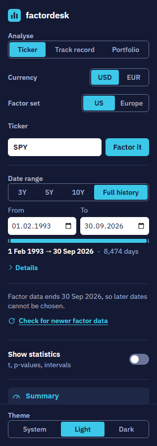

- **Analyse.** Choose **Ticker**, **Track record** or **Portfolio**.
- **Ticker.** Any Yahoo Finance symbol (`AAPL`, `SPY`, `BRK-B`, `NESN.SW`). Tickers you have
  already analysed are suggested as you type, with their company name.
- **Date range.** 3Y, 5Y, 10Y (the default) or Full history, or your own From and To dates. A preset
  is disabled when the history is too short, with the reason.
- **Currency.** **USD** or **EUR**. Your last choice is remembered.
- **Factor set.** **US** or **Europe** (Developed Europe five factors plus momentum). Macro, energy
  and world beta always use their US inputs.
- **Factor data.** The date the factor file ends, and **Check for newer factor data**. The Ken
  French library publishes with a lag of a month or more, so the newest prices are charted but not
  analysed; the sidebar says how many days that is.
- **Show statistics.** Adds t-statistics, p-values and intervals to every panel.
- **Theme.** System, Light or Dark.
- **Section list.** Jumps to a panel and highlights the one you are reading.

<br clear="right">

### Link parameters

| Parameter | Values | Default when missing |
| --- | --- | --- |
| `t` | a ticker | none |
| `m` | `track` or `portfolio` | ticker mode |
| `range` | `3Y`, `5Y`, `10Y`, `FULL`, or `start` and `end` as `YYYY-MM-DD` | `10Y` |
| `model` | `ff5` or `ff6` | `ff6` (five factors plus momentum) |
| `ccy` | `USD` or `EUR` | your last choice, else USD |
| `fs` | `europe` | the US factors |
| `stats` | `1` | statistics hidden |

For example, `http://127.0.0.1:8000/?t=AAPL&range=5Y&ccy=EUR&stats=1` opens Apple over five years
in euros with the statistics shown.

### Header

The header gives the name, exchange, currency and security type, a link to any warnings, the
analysis period, the number of days, the factor data's end date and the benchmark. Pills show
**Figures in EUR** and **US factors** or **Europe factors**. **What EUR changes** opens a short
explanation of how the euro view converts returns, cash and hedged lines. **Download report** saves
the analysis as an offline HTML file (ticker mode, USD).

## Panels

### Summary

The verdict in one paragraph, then two tables. *Performance* shows annualised return, volatility,
Sharpe ratio and maximum drawdown. *Factor model* shows alpha, R², residual volatility, the market
beta and the beta to world stocks. The *Reading* column says whether each number is clear evidence,
could be noise, or is probably biased. For example, R² is flagged as probably understated when the
closing prices are out of step with the factor data. Data notes sit directly under the verdict.

### Price and drawdown

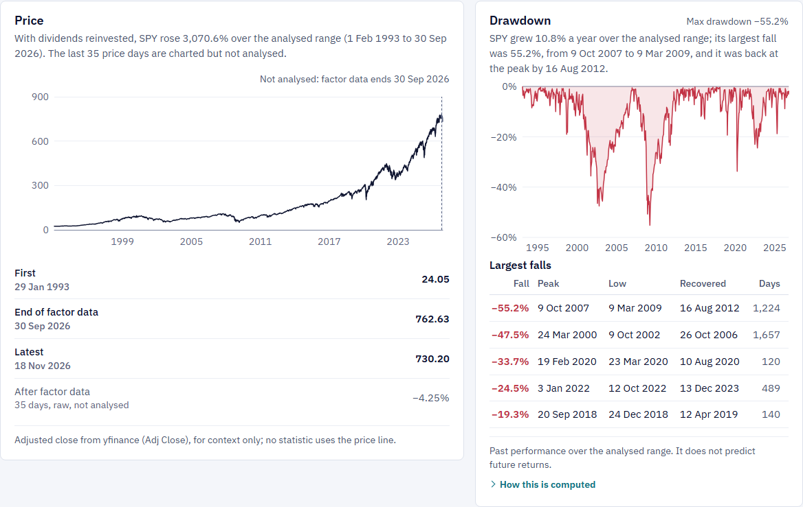

**Price** shows the adjusted close over the range, with the days after the factor data marked as
"not analysed". **Drawdown** shows how far the price stood below its previous peak on each day, the
largest fall with its peak, low and recovery dates, and a table of the five largest falls. Signed
returns are green when positive and red when negative.

### Factor exposures

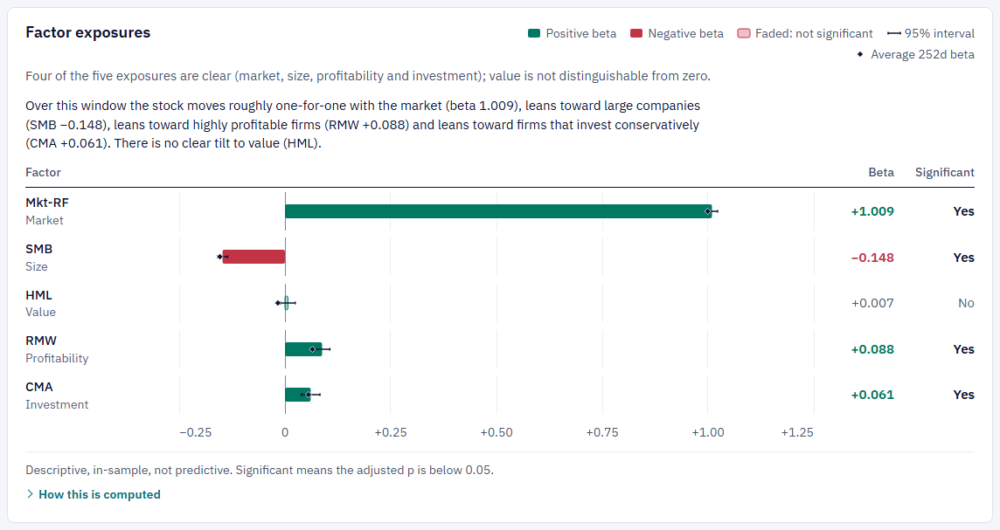

The core of the analysis. Each bar is a full-sample beta: how much the excess return moved with one
factor, holding the others fixed.

| Factor | Plain name | A positive beta means | A negative beta means |
| --- | --- | --- | --- |
| Mkt-RF | Market | moves with the market (1.0 is one-for-one) | moves against the market |
| SMB | Size | leans toward small companies | leans toward large companies |
| HML | Value | leans toward value stocks | leans toward growth stocks |
| RMW | Profitability | leans toward highly profitable firms | leans toward weakly profitable firms |
| CMA | Investment | leans toward firms that invest conservatively | leans toward firms that invest aggressively |
| MOM | Momentum (six-factor model only) | leans toward recent winners | leans toward recent losers |

Bars above zero are green and bars below zero red. A faded bar is not significant: its
Benjamini-Hochberg adjusted p-value is 0.05 or more, so the beta cannot be told apart from zero
([decision](decision-which-betas-count-as-reliable.md)). The whisker is the 95% interval and the
diamond is the average rolling beta. With **Show statistics** on, the table adds the t-statistic and
the average rolling beta:

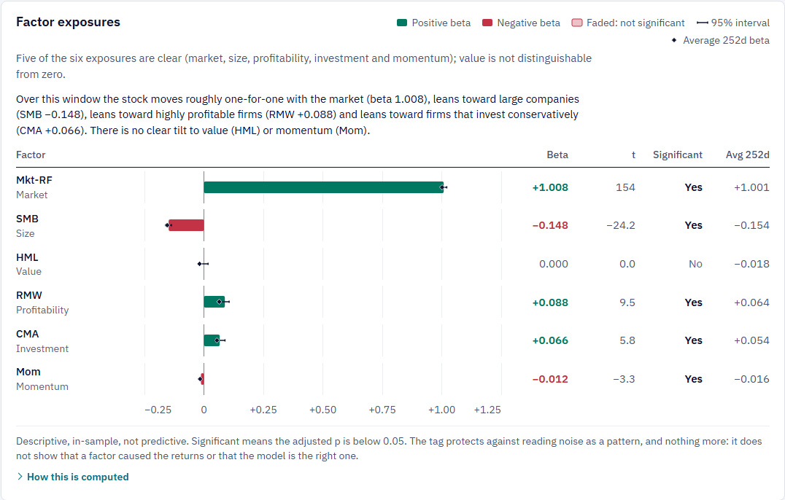

### Alpha across models

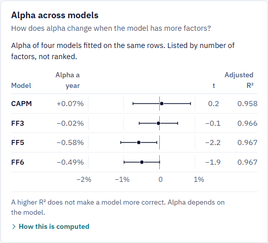

Alpha under CAPM, the three-factor, five-factor and six-factor models on the same days. An alpha
that shrinks as factors are added was a factor exposure, not skill
([decision](decision-factor-models-and-macro.md)).

### World beta

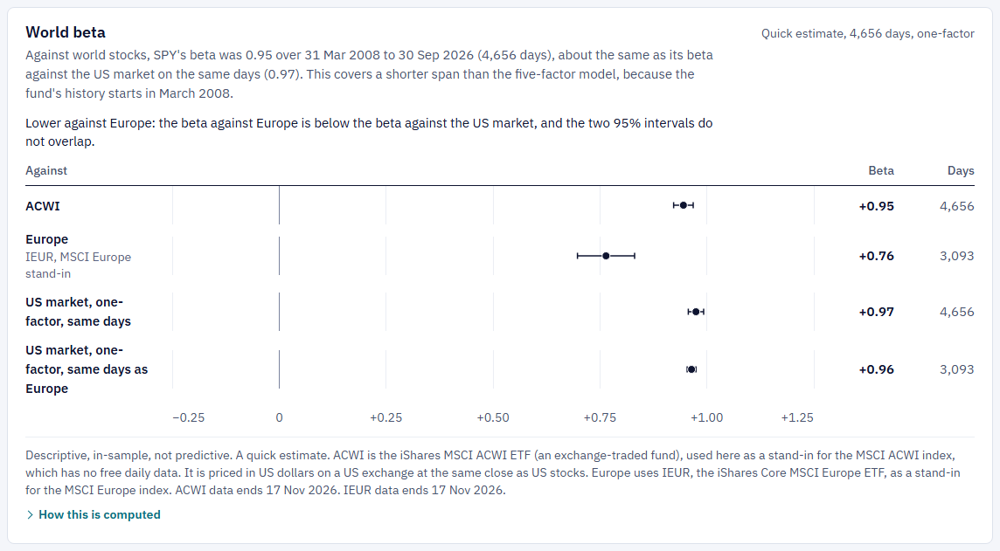

A quick single-factor check outside the US factor set: the beta against the iShares MSCI ACWI ETF
(a stand-in for the MSCI All Country World index) and the iShares Core MSCI Europe ETF (IEUR). Each
is shown next to a one-factor US market beta on exactly the same days, and the panel says whether
the two differ ([decision](decision-world-beta.md)).

### Return and risk sources

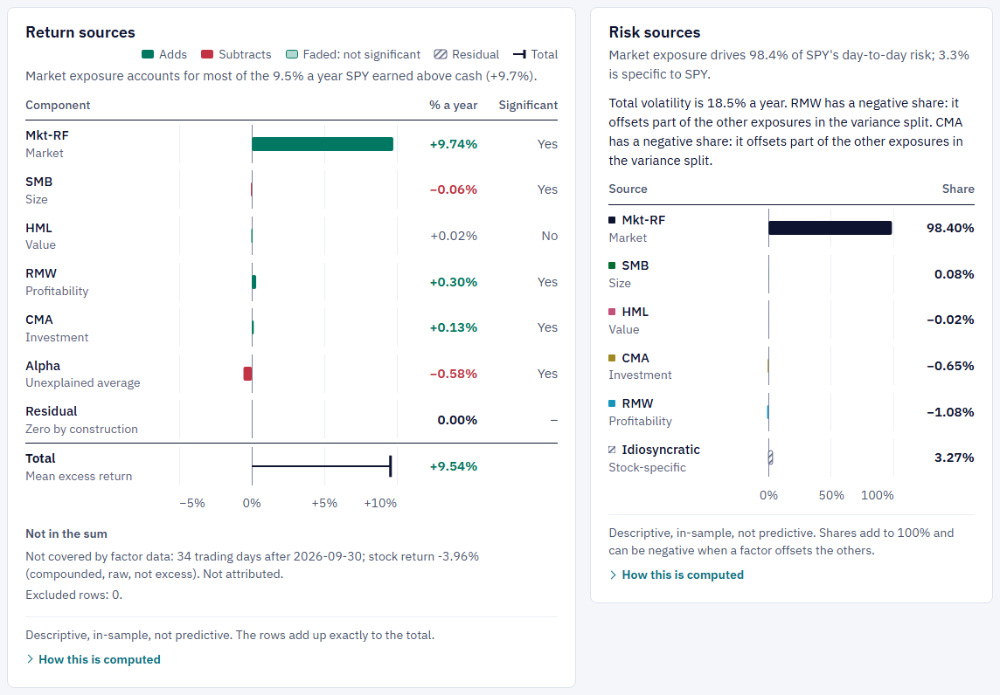

**Return sources** splits the average annual excess return into the part each factor explains
(beta times the factor's average return), alpha, and a residual that is zero by construction. The
rows add up exactly to the total. **Risk sources** splits the variance into factor shares and a
specific (idiosyncratic) share. Shares add to 100% and can be negative when one factor offsets the
others ([decision](decision-return-and-risk-attribution.md)).

### Tail risk

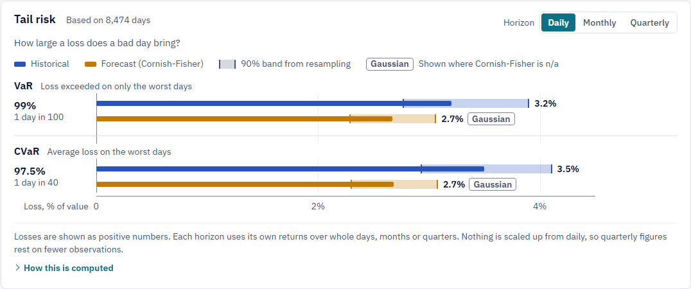

Value at risk (VaR) at 95% and 99%, and expected shortfall (CVaR) at 95% and 97.5%. Each figure has
a **Historical** bar (from the observed returns) and a **Forecast** bar (Cornish-Fisher, which
allows for skew and fat tails, or Gaussian when Cornish-Fisher does not apply) on one shared scale,
each with a 90% bootstrap band. Switch the horizon between **Daily**, **Monthly** and
**Quarterly**. A forecast is flagged as indicative when the Cornish-Fisher curve is not reliable
or its bootstrap band is wide. **How this is computed** gives the details
([decision](decision-var-and-cvar.md)).

### Macro sensitivities and energy

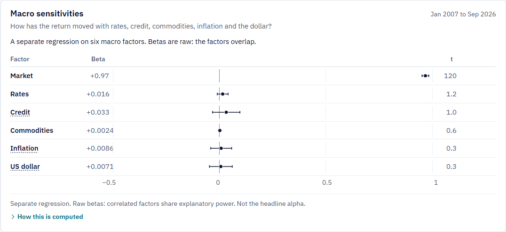

**Macro sensitivities** regress the excess return on the market and five macro legs built from
ETFs and FRED: rates (IEF minus cash), credit (LQD minus IEF), commodities (DBC minus cash),
inflation (TIP minus IEI) and the US dollar (the Federal Reserve's broad dollar index). Each row
shows a variance inflation factor (VIF) so you can see when two legs overlap.

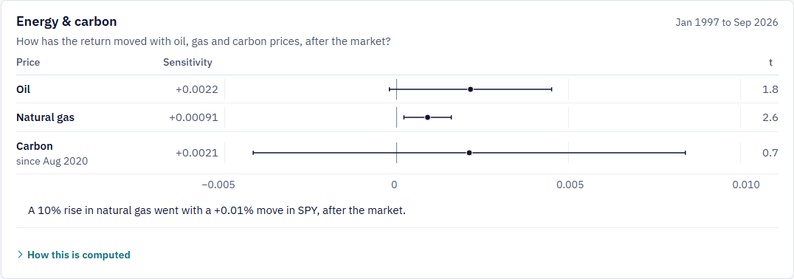

**Energy & carbon** regresses on the market plus Brent crude and Henry Hub natural gas, and, from
August 2020, a carbon model with the KRBN carbon allowance ETF (it needs at least two years). The
gas fit is repeated without its five largest moves so one spike cannot drive the result
([decision](energy-and-carbon-factors.md)).

### Exposure over time

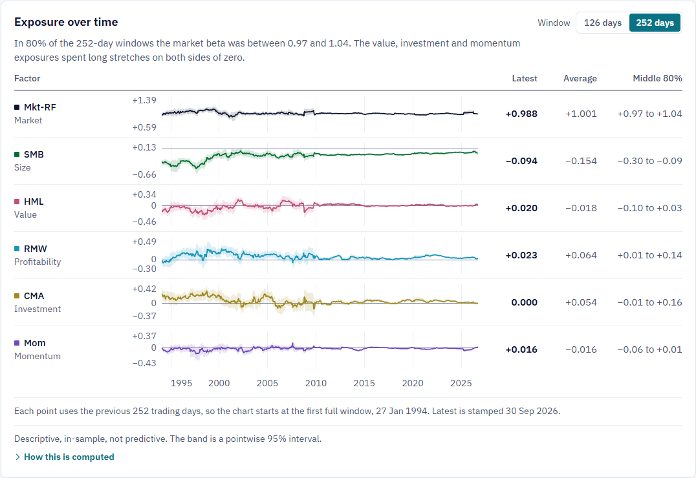

Rolling betas over the previous 126 or 252 trading days, with a pointwise 95% band. Each point uses
only past data. The table gives the latest value, the average and the range that holds the middle
80% of windows, and the result sentence says whether an exposure stayed stable or crossed zero.

### Deeper checks (five-factor model)

These panels test the headline numbers. They are built on the five-factor model, so they appear
when the model is FF5 (`model=ff5` in the URL); under the default six-factor model they are left
out.

**Beyond the factors** (residual alpha) compares the residual return under full-sample betas
(in-sample) with the residual under trailing 252-day betas known on each day (point-in-time). A
residual return that is only significant in-sample relied on hindsight. The panel reports the
residual return with its interval, volatility, information ratio, cumulative and compound growth,
hit rate, drawdown compared with what pure noise would give, skew and kurtosis
([decision](decision-residual-alpha-analysis.md)).

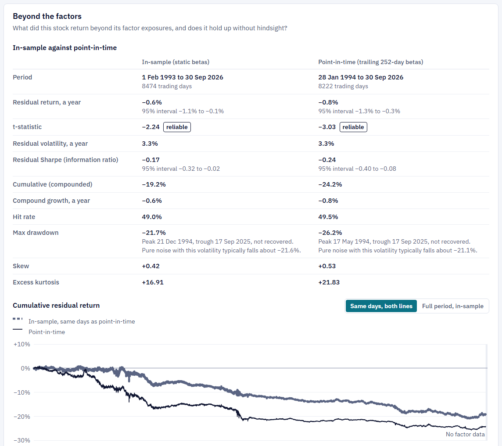

**Tracked day by day** (Kalman betas) lets each beta drift slowly and updates it with each day's
return, so every point uses only data up to its date. The drift rate is re-estimated once a year
and shown with its equivalent rolling window ([decision](decision-kalman-betas.md)).

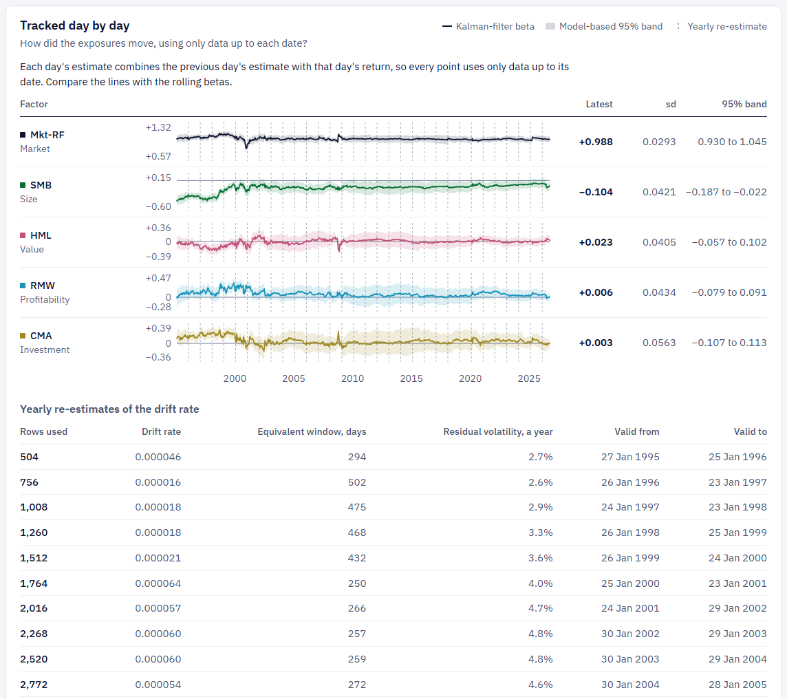

**Adjusted for noise** (shrunk betas) pulls each beta toward a prior in proportion to its
uncertainty (Vasicek), shows how far each one moved, and states the smallest effect the data could
have detected ([decision](decision-shrunk-betas.md)).

### Data and audit

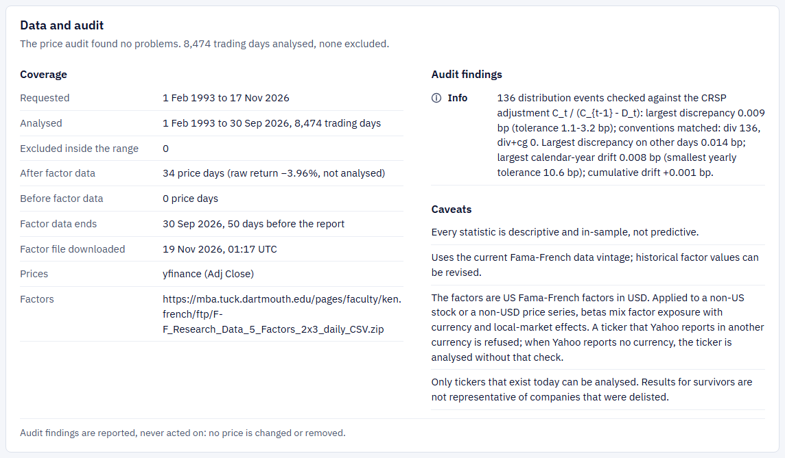

Coverage of the request, the days analysed and excluded, the factor file's end date, download time
and source URL, every audit finding (for example the check of distribution adjustments against the
CRSP convention) and every caveat that applies. Audit findings are reported, never acted on: no
price is changed or removed. A **Regression detail** panel at the end of the page holds the full
regression table and the residual diagnostics.

## Other modes and views

### Track record mode

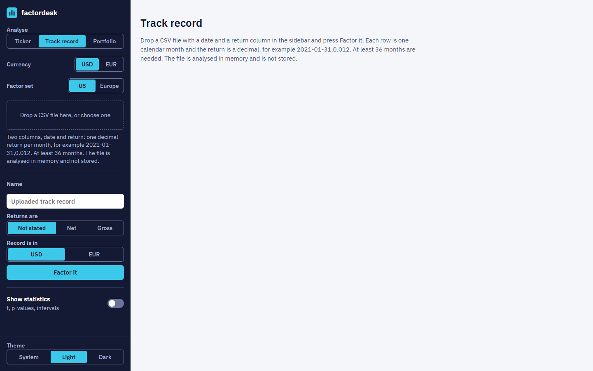

Drop a CSV file of monthly returns, or choose one. The file has a header row and two columns:

```text
date,return
2020-01-31,0.012
2020-02-29,-0.034
```

A date is `YYYY-MM-DD` or `YYYY-MM` and is moved to the month end; a return is a decimal (`0.012`
is 1.2%). Say whether the returns are **Gross**, **Net** or **Not stated**, and whether the record
is in **USD** or **EUR**. The file can be up to 1 MB, is held in memory only and is never written
to disk. The report uses monthly factors and has the same panels as a ticker where monthly data
allows; it has no **Download report** link ([decision](decision-monthly-track-records.md)).

### Portfolio mode

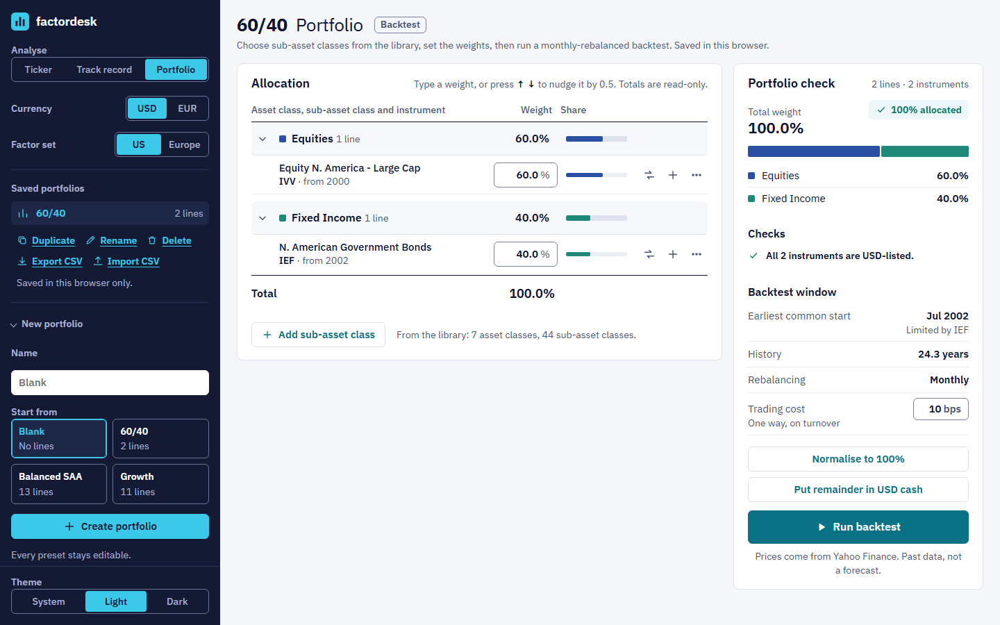

The composer has an allocation tree on the left and a live check panel on the right.

- **Build.** Start from **Blank**, **60/40**, **Balanced SAA** or **Growth**, or add lines from the
  library of 44 asset classes. Each line has a proxy ETF; lines without one are greyed ("No proxy
  yet"). Keep several named portfolios, rename them, delete them, and undo a delete.
- **Check.** The live panel shows the total, any unallocated weight (it goes to cash in the
  reference currency), and the trading cost in basis points. **Normalise to 100%** and **Put
  remainder in USD cash** fix the total in one click.
- **Share.** **Export CSV** and **Import CSV** round-trip a portfolio exactly; an import error names
  the line at fault.
- **Run backtest.** A monthly-rebalanced backtest of up to 50 instruments over the period they all
  trade, analysed with the six-factor model by default. In the euro view, lines are tagged
  "hedged to EUR", "not hedged: several currencies" or "USD cash, not hedged".

The portfolio report adds two panels. **Backtest** gives the window, the holdings that limit it,
the number of rebalances, the cost and the unallocated weight. **Holdings** gives each line's target
and end weight, return contribution and risk share, rolled up through the tree
([decision](decision-portfolio-backtest-rules.md)).

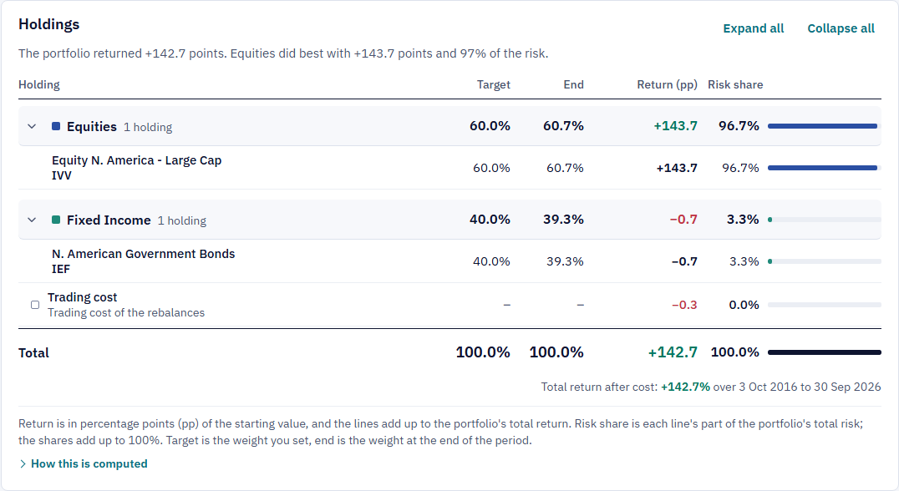

### The euro view and the Europe factors

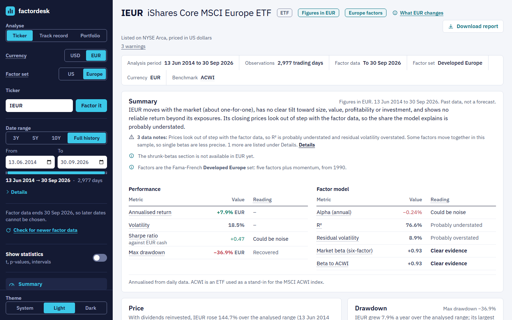

With **Currency** on **EUR**, every price is converted to euros at the daily ECB reference rate,
cash earns €STR (EONIA before October 2019), and US bond lines in a portfolio are hedged to euros.
With **Factor set** on **Europe**, the regression uses the Ken French Developed Europe factors. The
two switches are independent ([currency decision](decision-reference-currency.md),
[factor set decision](decision-europe-factor-set.md)).

### Dark theme

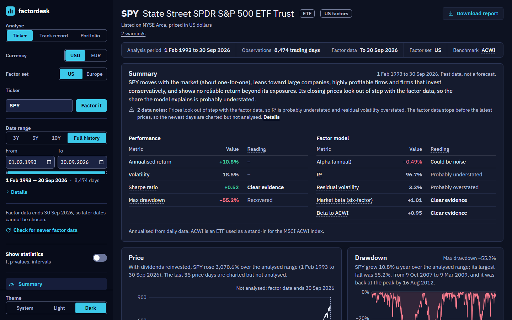

### On a phone

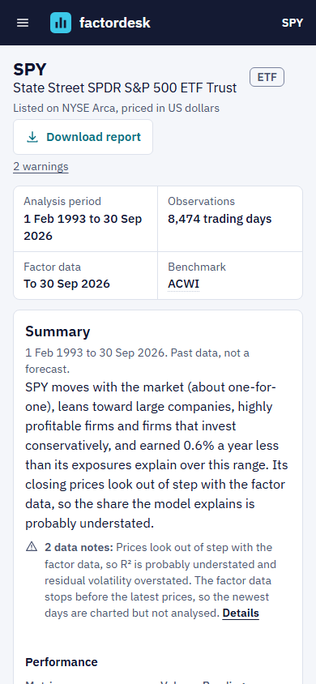

Under 900 px the sidebar becomes a top bar with a menu, and every panel stacks into one column. No
text is smaller than 14 px at any width.
