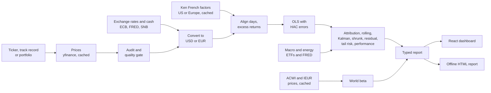

# How factordesk works

Last updated 2026-11-28. The path from a ticker to a report, the statistical method, the checks behind the numbers, the known limits and the key references. The binding rules are in [docs/methodology.md](../docs/methodology.md); this page summarises them.

## From ticker to report

1. **Data.** Daily adjusted closes come from Yahoo Finance through yfinance, with one cached
   metadata read for the name, exchange and currency. Listings in USD, EUR, GBP (pence are divided
   by 100), CHF, JPY, CAD, AUD, HKD, SEK, NOK and DKK are accepted; other currencies are refused
   with a plain message. Exchange rates and euro cash rates come from the ECB, with FRED as a
   fallback; Swiss franc cash comes from SARON at the Swiss National Bank. The factor files come
   from the Kenneth R. French Data Library and are refreshed automatically once they are more than
   40 days old. Each source and its terms are in [Data sources and their terms](guide-data-sources.md).
2. **Audit.** Distributions and splits are checked against the CRSP adjustment convention, extreme
   days are flagged, and a quality gate tests whether the closing prices are synchronous with the
   factor data ([decision](decision-spy-timing-noise-and-the-quality-gate.md)).
3. **Analysis.** The excess return is regressed on the factors over the days where prices and
   factors overlap; every other section builds on that sample. Track records and portfolios use
   monthly data.
4. **Report.** The result is one typed report (`backend/factordesk/report/schema.py`, schema
   version 4). The dashboard and the offline HTML renderer both read it. Optional sections carry a
   status (ok, insufficient data, not applicable or failed), so one failing section never breaks the
   page ([decision](decision-schema-v3-contract.md)).

The backend is a FastAPI server (`backend/factordesk/api/`). The page is React and TypeScript built
with Vite, with plain CSS tokens and ECharts for the line charts. The TypeScript types are generated
from the backend's OpenAPI schema, and CI fails if they drift
([decision](decision-application-stack.md)).

## Method

The excess return is regressed by ordinary least squares on the Fama-French factors: the five
factors Mkt-RF, SMB, HML, RMW and CMA
([Fama and French 2015](https://doi.org/10.1016/j.jfineco.2014.10.010)), plus momentum (MOM) in the
six-factor model that the dashboard uses by default.

- **Inference.** Newey-West HAC standard errors, so autocorrelation and changing volatility do not
  overstate significance ([decision](decision-daily-returns-and-robust-errors.md)).
- **Multiple testing.** The betas are corrected together with Benjamini-Hochberg at 5%.
  "Significant" always means the adjusted p-value is below 0.05
  ([decision](decision-which-betas-count-as-reliable.md)).
- **Attribution.** Return and risk attribution add up exactly to the totals.
- **No look-ahead where it matters.** Rolling, Kalman and point-in-time residual results use only
  data available on each day ([decision](decision-no-look-ahead-rule.md)).
- **Performance.** Annualised from daily data; the Sharpe ratio interval follows Lo (2002) under an
  iid assumption.
- **Tail risk.** Historical and Cornish-Fisher VaR and CVaR with bootstrap bands.
- **Quality gate.** Flags closing prices that are not synchronous with the factor data, which
  biases R² down and residual volatility up.

The binding statistical rules are in [docs/methodology.md](../docs/methodology.md) (M0 to M16); the
method in prose is in [docs/overview.md](../docs/overview.md#method-in-detail).

## Scientific rigour

The [research protocol](../docs/research-protocol.md) is the rule: write the hypothesis and the
exact test down before results, enter every run in an append-only
[test registry](../docs/registry/tests.jsonl), correct for multiple tests, report power, and never
use data from after the date a result is stamped. The registry shows that the quality-gate
threshold was written after 13 inspection runs, so it is a documented heuristic and not a
pre-registered test; the protocol applies from then on.

Also in place:

- an independent recomputation of the SPY report, and mutation testing
  ([docs/validation/](../docs/validation),
  [decision](decision-independent-validation-and-mutation-testing.md));
- an independent review of every analytics section before merge ([docs/reviews/](../docs/reviews));
- real-data validation of the euro view and the Europe factors
  ([Sprint 3](../docs/research/sprint-3-validation.md),
  [Sprint 4](../docs/research/sprint-4-validation.md));
- a written [test oracle](../docs/test-oracle.md) with tolerances;
- Monte Carlo tests of the Kalman filter at 200 replications (`uv run pytest -m slow`, run before
  each release);
- pinned lockfiles and fixed seeds;
- a bibliography where every source was checked ([docs/references.md](../docs/references.md),
  [decision](decision-citations-and-verification.md)).

## Limitations

- Results are descriptive and in-sample, not forecasts. Past exposures may not persist.
- The factor files lag by a month or more, so the newest prices are charted but not analysed.
- The command-line report covers US-dollar tickers and the US five-factor model only; the offline
  HTML report is in US dollars only.
- The Europe factor set covers developed Europe only; other regions are not available yet.
- ACWI, IEUR and the macro legs are ETFs standing in for indices, which have no free daily data.
- A portfolio backtest holds at most 50 instruments and starts when the youngest proxy starts.
- SPY's early Yahoo closes carry timing noise that the quality gate flags but does not remove.
- Only tickers that exist today can be analysed, so results carry survivorship bias.
- Not yet verified: screen readers, Firefox and Safari, and printing the dashboard page.

The full list is in [docs/overview.md](../docs/overview.md#limitations). Claims in the repository
without a source are listed in
[docs/references.md](../docs/references.md#claims-in-the-repo-without-a-source).

## Key references

Verification means a work exists with these details, not that each paper's text was checked against
how the repository uses it. Full entries are in [docs/overview.md](../docs/overview.md#key-references)
and [docs/references.md](../docs/references.md).

1. Fama and French (2015), *J. Financial Economics* 116(1), [doi](https://doi.org/10.1016/j.jfineco.2014.10.010): the five-factor model.
2. Fama and French (1993), *J. Financial Economics* 33(1), [doi](https://doi.org/10.1016/0304-405X(93)90023-5): the three-factor model.
3. Carhart (1997), *J. Finance* 52(1), [doi](https://doi.org/10.1111/j.1540-6261.1997.tb03808.x): momentum as a fourth factor.
4. French, [Kenneth R. French Data Library](https://mba.tuck.dartmouth.edu/pages/faculty/ken.french/data_library.html): factor data.
5. Newey and West (1987), *Econometrica* 55(3), [doi](https://doi.org/10.2307/1913610): HAC errors.
6. Benjamini and Hochberg (1995), *J. Royal Statistical Society B* 57(1), [doi](https://doi.org/10.1111/j.2517-6161.1995.tb02031.x): multiple testing.
7. Kalman (1960), *J. Basic Engineering* 82(1), [doi](https://doi.org/10.1115/1.3662552): Kalman betas.
8. Vasicek (1973), *J. Finance* 28(5), [doi](https://doi.org/10.2307/2978759): shrunk betas.
9. Dimson (1979), *J. Financial Economics* 7(2), [doi](https://doi.org/10.1016/0304-405X(79)90013-8): lead-lag betas (specified).
10. Scholes and Williams (1977), *J. Financial Economics* 5(3), [doi](https://doi.org/10.1016/0304-405X(77)90041-1): lead-lag cross-check (specified).

López de Prado (2023), *Causal Factor Investing* ([doi](https://doi.org/10.1017/9781009397315)), is
cited as a source for scientific rigour: it shapes how results are worded and qualified, and none of
factordesk's algorithms are taken from it ([decision](decision-causal-discipline-guardrails.md)).
